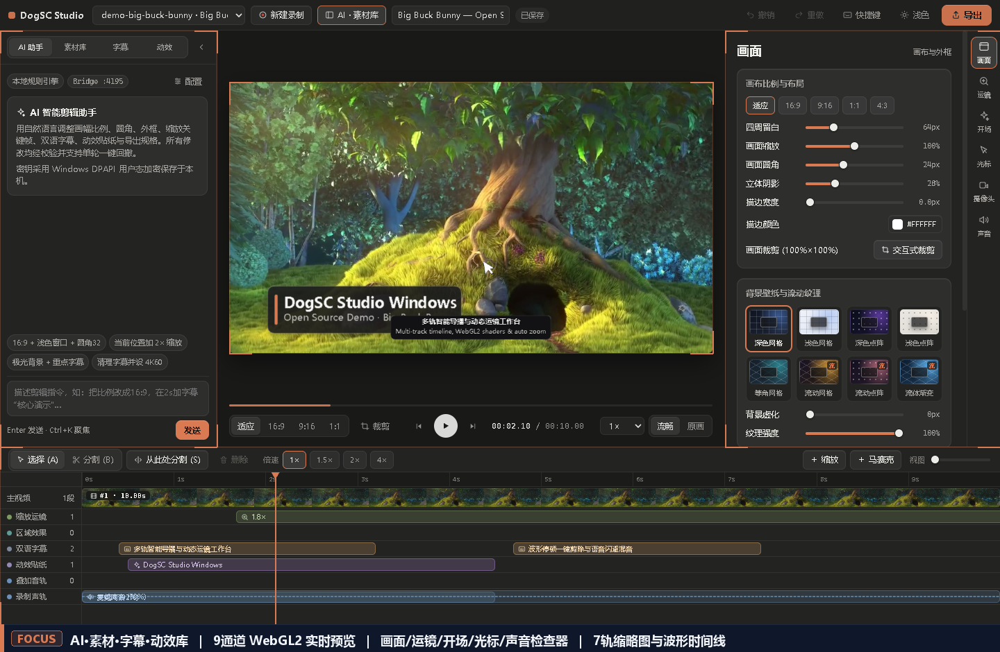
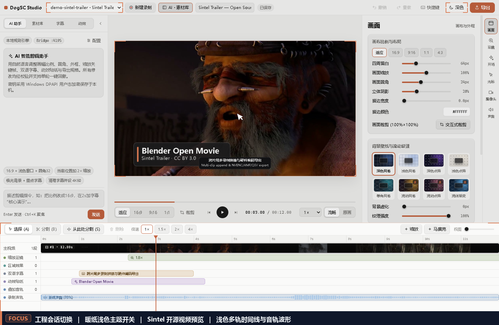
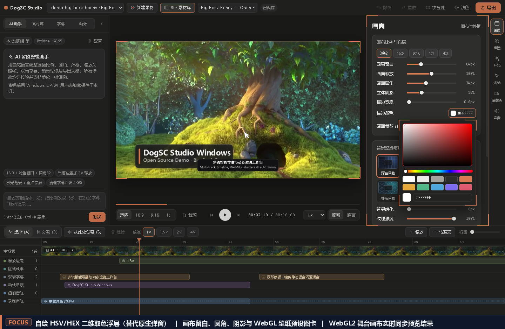
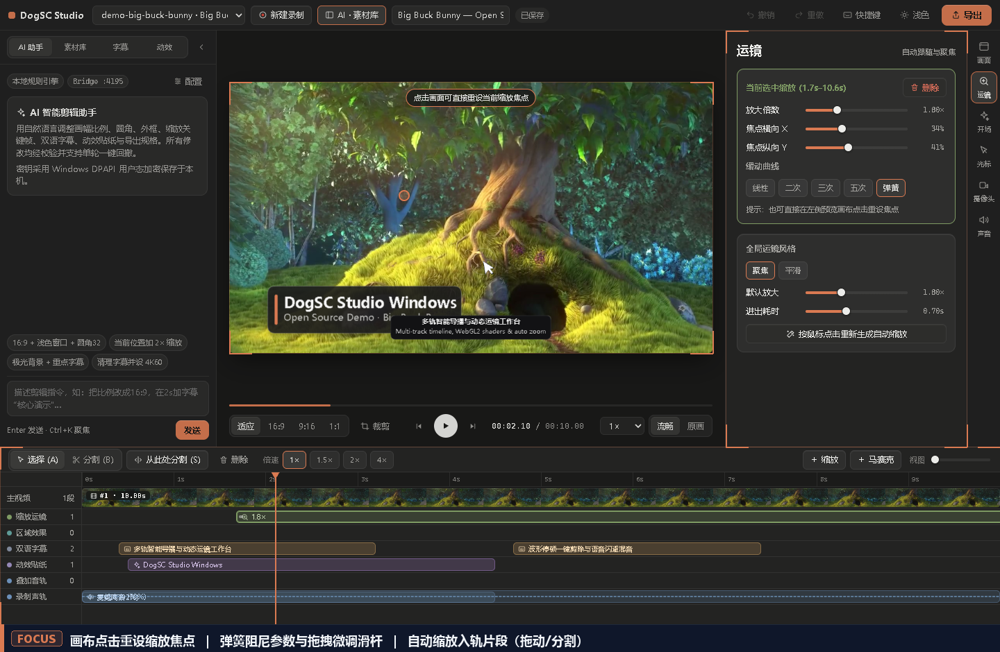
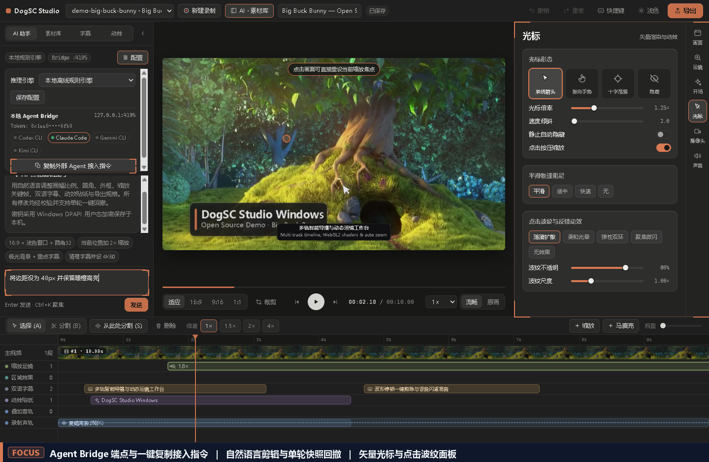
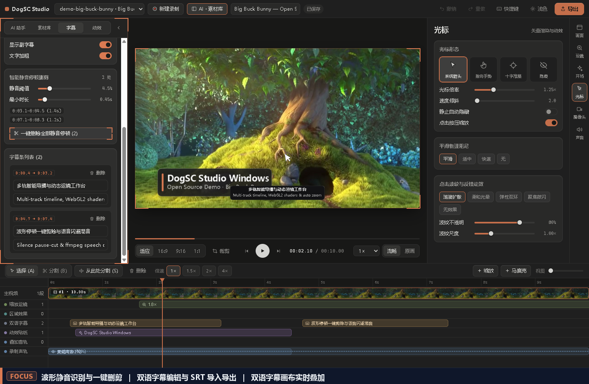
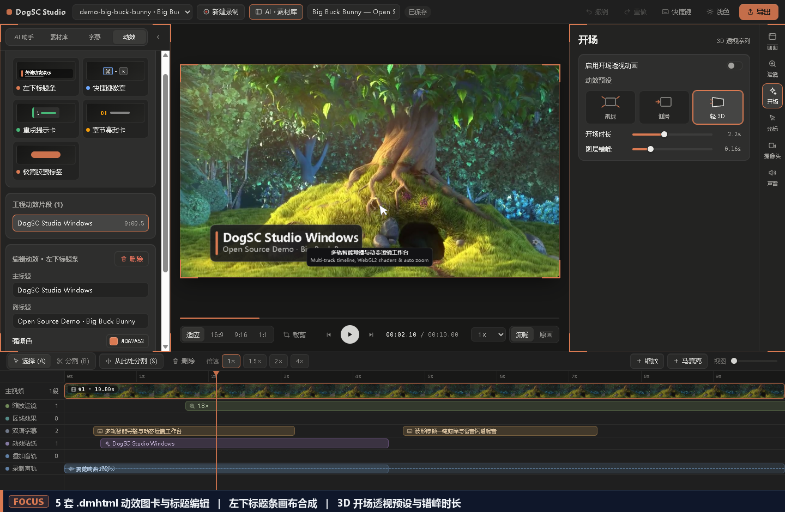
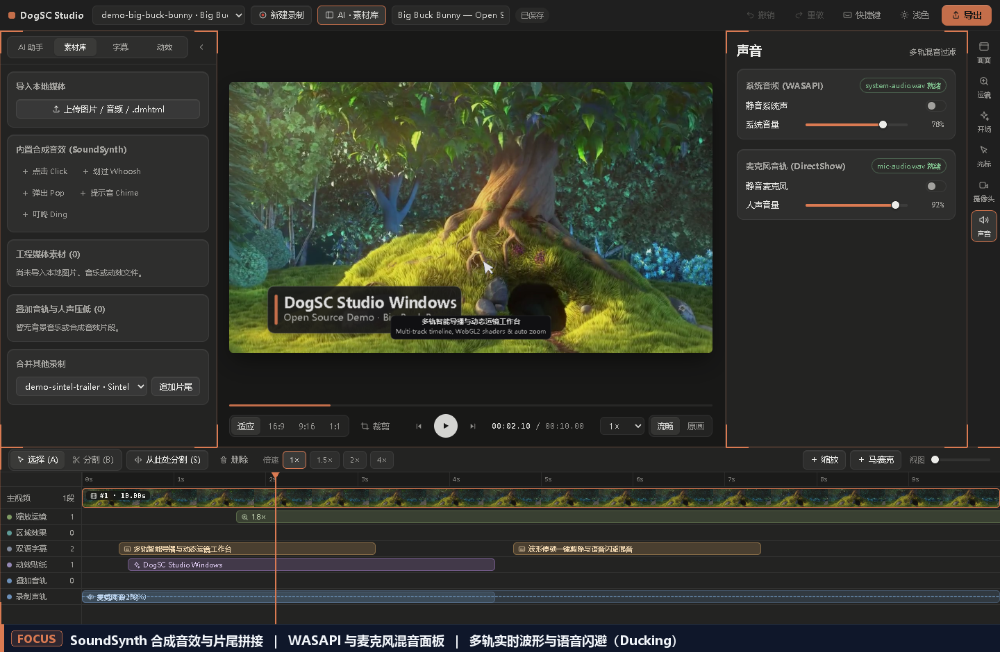
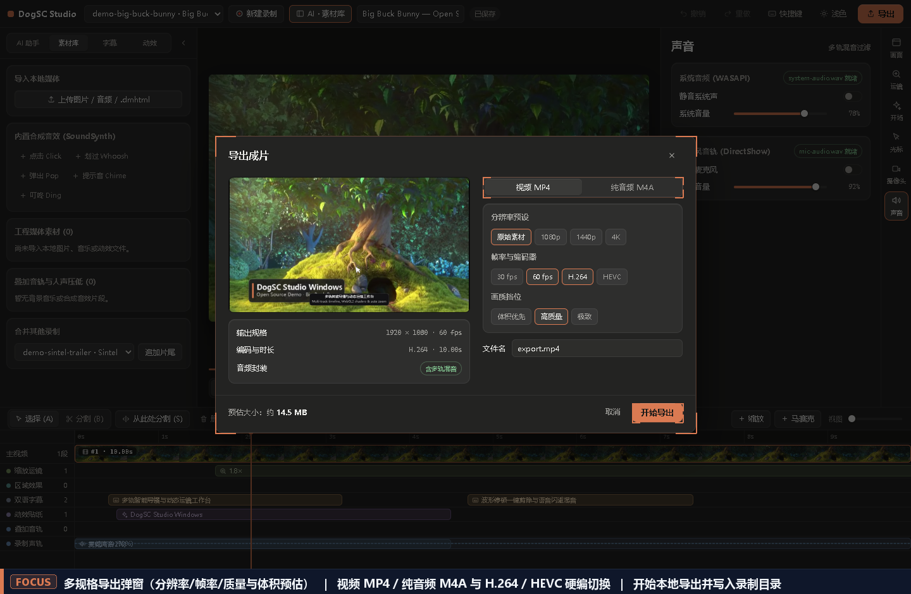

[中文](README.md) | [English](README.en.md)

# DogSC Windows (`v1.2.0`)

A multi-source Windows screen recorder and WebGL2 non-linear studio editor, porting the core timeline and zoom planning engine from [laogou717/dogsc](https://github.com/laogou717/dogsc) while rebuilding capture, GPU hardware encoding, native tray hosting, and local Agent automation specifically for Windows.

> Demo screenshots in this README use Blender Foundation CC BY 3.0 open-movie footage (*Big Buck Bunny* and *Sintel*).

---

## Highlights

- **Hardware-Accelerated Capture**: Captures 60fps desktop video via `ddagrab` (with `gdigrab` fallback), paired with DirectShow microphone/webcam feeds, WASAPI loopback system audio, and a low-level `WH_MOUSE_LL` pointer hook. Probes single-frame hardware encoders in order (`h264_nvenc` → `h264_amf` → `h264_qsv`) and falls back automatically to `libx264`.
- **0.5s Crash-Resilient Fragmented MP4**: Screen and camera capture write `fMP4` (`+frag_keyframe+empty_moov+default_base_moof`, `-frag_duration 500000`) so footage flushed before an unexpected exit or power loss remains readable.
- **Bidirectional Schema `v27`/`v28` Compatibility**: `src/core/` preserves project schemas, spring-damped auto-zoom planning, and timeline mapping compatible with the upstream macOS repository.
- **9-Pass WebGL2 Studio & 7-Track Timeline**: Real-time compositing for canvas padding, animated procedural shaders and wallpapers, window/device frames, focus-target zoom keyframes, vector cursors with click ripples, 3D opening sequences, bilingual subtitles, and `.dmhtml` motion graphics.
- **Stealth Teleprompter Memo Overlay**: Built into `desktop/DogSC.cs` using `SetWindowDisplayAffinity(WDA_EXCLUDEFROMCAPTURE)` (`Ctrl+Alt+Shift+N`) so your script stays visible to you on top of any window while remaining invisible in screen captures and meetings.
- **AI Editing Assistant & Local Agent Bridge**: Includes an offline rule engine and DPAPI-encrypted OpenAI / Gemini routing, plus an authenticated local HTTP bridge (`Authorization: Bearer <32-hex>`) that lets external AI CLIs inspect and edit timelines with single-turn snapshot revert.

---

## Studio Walkthrough

### 1. Studio Overview (Warm Graphite Dark Theme)



Four-zone workspace: top project switcher & export bar, collapsible left drawer (`AI Assistant / Assets / Subtitles / Motion`), central 9-pass WebGL2 monitor, six-tab right inspector, and a 7-track interactive timeline (`Main Video filmstrip`, `Zoom`, `Spotlight/Mosaic`, `Bilingual Subtitles`, `Motion`, `Overlay Audio`, `Recorded Audio waveforms`).

### 2. Warm Paper Light Theme



Switch seamlessly between Warm Graphite dark mode and Warm Paper light mode from the chrome bar while hopping across recording sessions from the session picker.

### 3. Frame Presets & Self-Drawn HSV/HEX Color Picker



Visual cards for 8 shader/pattern backgrounds and 7 window/device frames, paired with a self-drawn 2D SV + Hue popover picker instead of OS modal dialogs.

### 4. Auto Zoom Inspector & Scrub Numeric Controls



Click anywhere on the preview canvas to retarget zoom focus, select linear/cubic/quintic/spring easing, drag numeric readouts horizontally to scrub values (`Shift` for `0.25×` precision), and double-click to reset defaults.

### 5. AI Editing Assistant & Local Agent Bridge



Apply natural-language timeline edits with single-turn rollback, inspect detected local CLIs (`codex` / `claude` / `gemini` / `kimi`), and copy the ready-to-use Bearer-authenticated bridge configuration for external coding agents.

### 6. Bilingual Subtitles & Audio Pause-Cut



Detect low-energy silent intervals from microphone waveforms for one-click pause removal, edit primary/secondary subtitles inline with `.srt` import/export, and preview 5 entrance animations.

### 7. `.dmhtml` Motion Templates & 3D Opening Presets



Five built-in `.dmhtml` parametric templates (`Lower Third`, `Shortcut Badge`, `Callout Card`, `Chapter Slate`, `Minimal Pill`) with standalone `.dmhtml` export and staggered 3D opening presets.

### 8. Synthesized SFX, Clip Append & Voice Ducking



Generate 48kHz procedural SFX (`SoundSynth`), append another session onto the active timeline, and balance WASAPI/mic/overlay levels with automatic FFmpeg speech ducking during export.

### 9. Multi-Spec Export Sheet



Switch between `MP4` video and `M4A` audio-only outputs, pick resolution (`Original / 1080p / 1440p / 4K`), frame rate (`30 / 60 fps`), `H.264 / HEVC` encoder, quality preset, and preview estimated size.

---

## Requirements & Quick Start

### 1. Host Prerequisites

| Dependency | Requirement | Role |
| :--- | :--- | :--- |
| Node.js | `>= 22.18.0` | Runs native `.ts` modules directly via type stripping without a JS bundler |
| FFmpeg / FFprobe | Recommended `7.x+` (with NVENC/AMF/QSV) | Screen capture, hardware encoder probing, waveform extraction, pause detection, and final export (not bundled in this repo) |
| Browser | Microsoft Edge or Google Chrome | Drives WebGL2 rendering and serves as the desktop App/WebView container |
| .NET `csc.exe` (optional) | Built-in `.NET Framework 4.x` on Windows | Only needed when recompiling `desktop/DogSC.cs` into `dist/DogSC.exe` |

Install `Node.js` and `FFmpeg` quickly via `winget`:

```powershell
winget install OpenJS.NodeJS.LTS
winget install Gyan.FFmpeg
```

### 2. Run from Source & Package for Windows

```powershell
git clone <your-fork-url> dogsc-win
cd dogsc-win

# 1) Start the local Web Studio server (reads/writes recordings/ by default)
npm run studio

# 2) Run the automated test suite
npm test

# 3) Compile the native tray shell (dist\DogSC.exe) and run host diagnostics
npm run build:desktop
.\dist\DogSC.exe --check --root .
.\dist\DogSC.exe --memo-check

# 4) Build standard lightweight Windows artifacts (DogSC.exe / ZIP / Setup.exe / SHA256SUMS.txt)
npm run package:win

# 5) Or build the portable ZIP bundling runtime\node.exe
npm run package:win:portable
```

### 3. CLI Recording, Export & Verification

```powershell
# Capture 10s of the primary display at 60fps CFR (writes recordings/<YYYYMMDD-HHmmss>/)
node scripts/record.ts --seconds 10 --fps 60 --display 0

# Export 4K HEVC MP4 or mixed audio-only M4A
node scripts/export.ts --dir recordings\<session-id> --resolution 4K --fps 30 --codec hevc --quality maximum
node scripts/export.ts --dir recordings\<session-id> --format m4a --out audio.m4a

# Verify head/tail frames and A/V sync against the source session
node scripts/verify-export.ts --dir recordings\<session-id> --sync

# Probe local displays, DirectShow devices, and GPU encoder availability
node scripts/run-device-matrix.ts
```

For keyboard shortcuts, tray arguments, and detailed editor tips, see [docs/USAGE.md](docs/USAGE.md).

---

## Configure & Connect via Your AI Agent

Paste the prompt below into `Claude Code`, `Codex`, `Gemini CLI`, or `Cursor` to let your local agent inspect host binary paths and connect to Studio's Agent Bridge:

```text
Inspect and verify my local DogSC Windows setup (repo path: <path-to-dogsc-win>):
1. Run `node -v` (requires >= 22.18.0), `where.exe ffmpeg`, `where.exe ffprobe`, and `.\dist\DogSC.exe --check --root .` to confirm exact executable paths for Node.js, FFmpeg/FFprobe, and Edge/Chrome; provide exact `winget` commands if anything is missing.
2. If native tray compilation is needed, run `npm run build:desktop` and verify capture exclusion with `.\dist\DogSC.exe --memo-check`.
3. To edit a recording over Local Agent Bridge, read the Bearer token copied from Studio's left "AI 助手 -> 配置" panel, then call `POST http://127.0.0.1:<port>/api/recordings/<recordingId>/ai/command` with `Authorization: Bearer <token>`. Undo any step via `/ai/revert`.
```

Supported bridge tool operations (`set_canvas`, `add_zoom`, `split_segment`, `add_subtitle`, `clean_subtitles`, `add_motion`, `set_export`) are defined in [src/server/AgentBridge.ts](src/server/AgentBridge.ts).

---

## Repository Structure

```text
dogsc-win/
├── src/
│   ├── core/        # Upstream-derived timeline, zoom planning & Schema v27/v28 models (MIT)
│   ├── capture/     # ddagrab/gdigrab, DirectShow, WASAPI, WH_MOUSE_LL & session alignment
│   ├── render/      # Frame plan, FFmpeg audio ducking mixer, SoundSynth & export verifier
│   ├── server/      # StudioServer HTTP/SSE backend, export queue & AgentBridge
│   └── desktop/     # WinForms icon synth, toolchain discovery & IExpress packaging helpers
├── web/             # 9-pass WebGL2 compositor & DogSC Studio UI (no build step required)
├── desktop/         # Native C# tray host & capture-excluded teleprompter (DogSC.cs)
├── scripts/         # CLI entry points for recording, export, calibration & packaging
├── tools/           # PowerShell WASAPI loopback & global low-level mouse hook helpers
├── docs/            # Usage manual & architecture DAG (internal plans archived under docs/archive/)
└── test/            # Core parity, render contracts, server routes & desktop packaging tests
```

---

## Licensing & Upstream Attribution

This repository applies a clear **dual-license boundary**:

1. **Upstream Core Port ([LICENSE-MIT](LICENSE-MIT) — MIT License)**  
   All files under `src/core/` are derived from [laogou717/dogsc](https://github.com/laogou717/dogsc) and remain licensed under the **MIT License**.

2. **Original Windows Implementation ([LICENSE](LICENSE) — PolyForm Noncommercial License 1.0.0)**  
   All Windows-specific modules outside `src/core/` (`src/capture/`, `src/render/`, `src/server/`, `src/desktop/`, `web/`, `desktop/`, `scripts/`, `tools/`) are licensed under **PolyForm Noncommercial License 1.0.0**:
   - Individual developers may freely fork, study, run, and modify the code locally for noncommercial purposes;
   - Commercial use, commercial redistribution, or resale is not permitted under this license.

Third-party dependency notices (FFmpeg, Node.js, Microsoft Edge WebView) are documented in [THIRD_PARTY_NOTICES.md](THIRD_PARTY_NOTICES.md).
