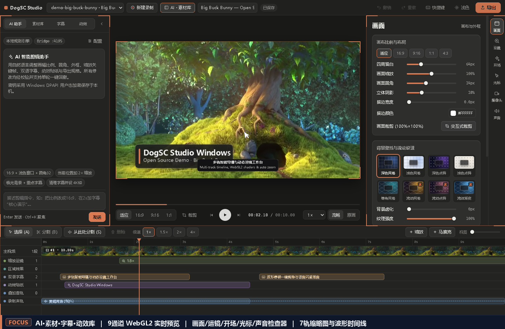
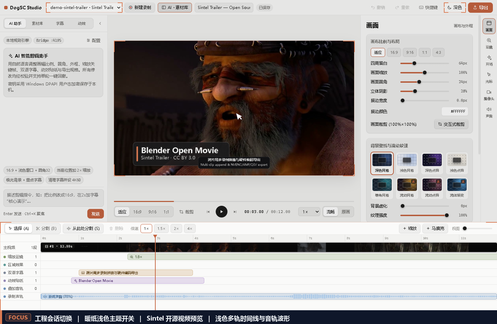
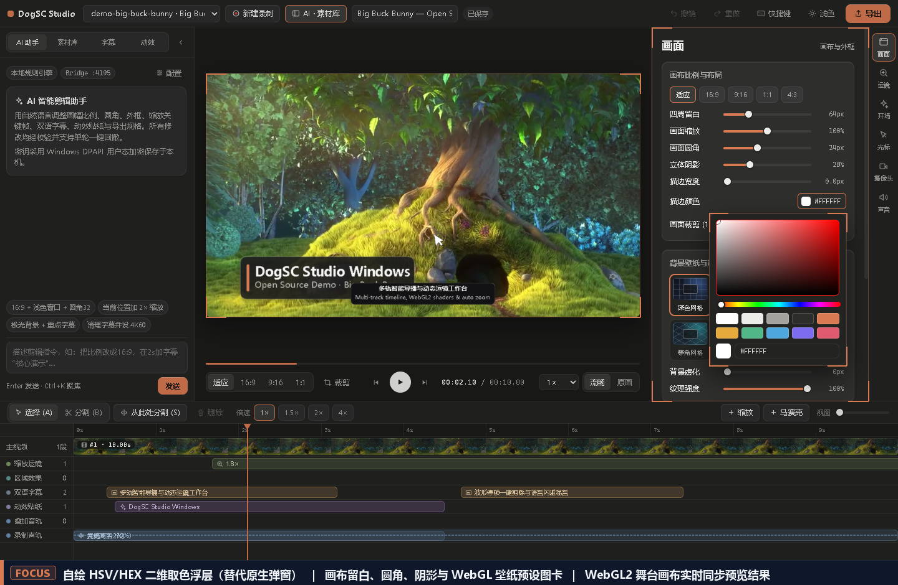
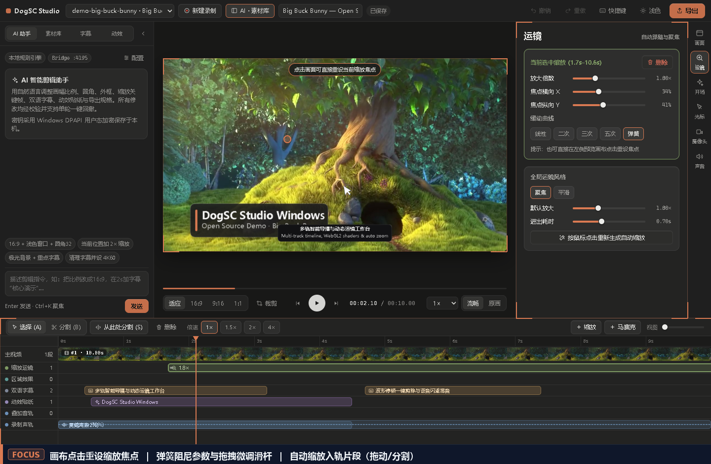
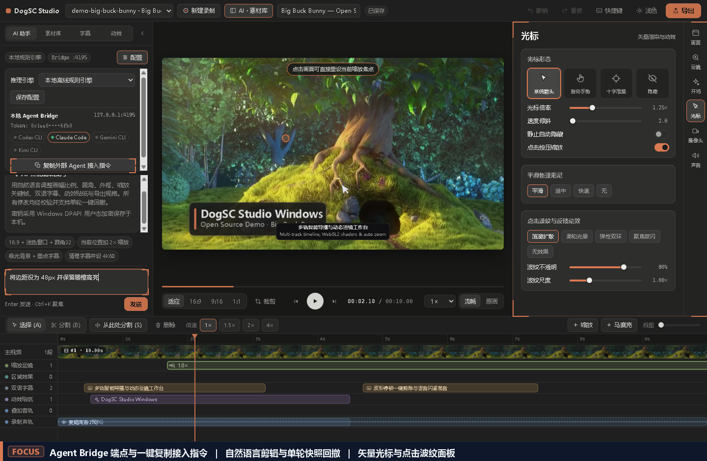
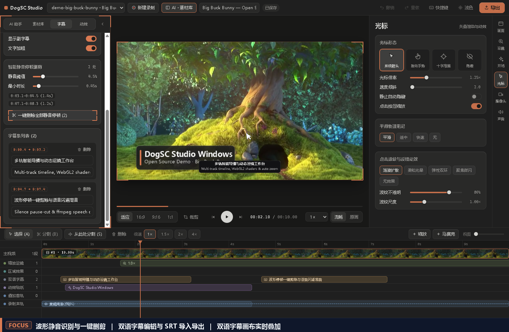
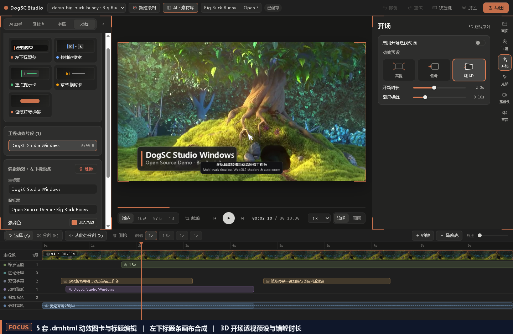
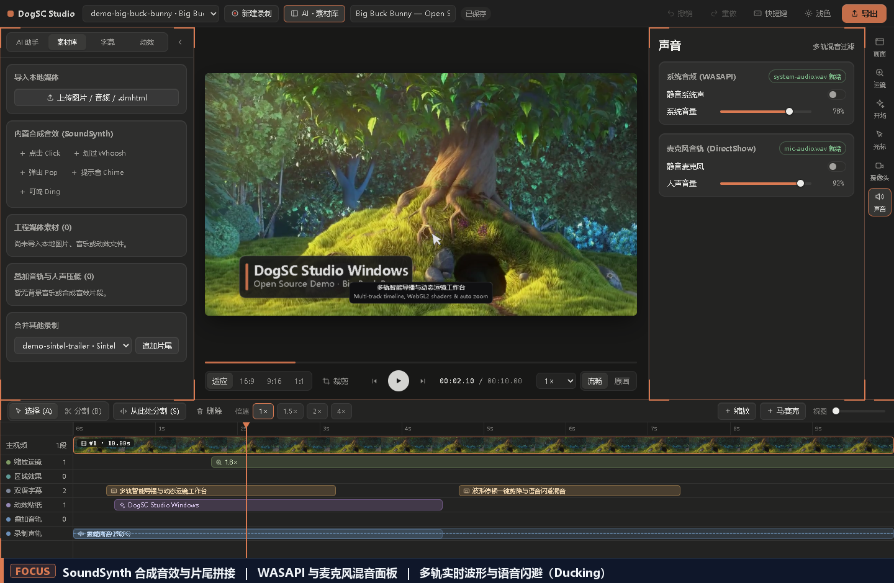
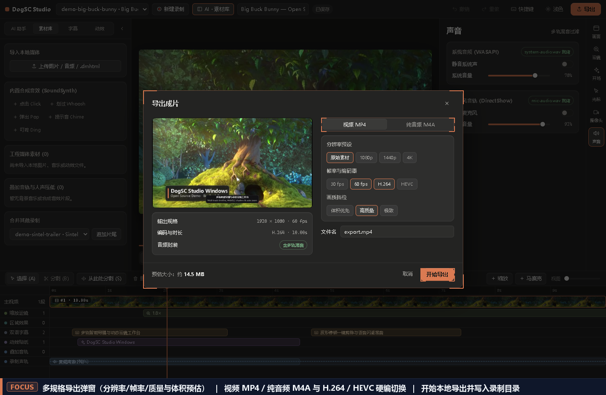

[中文](README.md) | [English](README.en.md)

# DogSC Windows (`v1.2.0`)

面向 Windows 桌面的多源屏幕录制与 WebGL2 非线性后制工作台，基于 [laogou717/dogsc](https://github.com/laogou717/dogsc) 核心算法移植并在 Windows 侧重建采集、渲染、桌面外壳与本地 Agent 接入能力。

> 本文档演示截图使用 Blender Foundation CC BY 3.0 开源短片 *Big Buck Bunny* 与 *Sintel* 作为测试画面。

---

## 核心特性

- **低开销硬件采集**：优先使用 `ddagrab`（自动回退 `gdigrab`）采集 60fps 屏幕画面，结合 DirectShow 麦克风/摄像头、WASAPI 系统回环录音与全局低级鼠标钩子（`WH_MOUSE_LL`）；启动录制时依次探测 `h264_nvenc` → `h264_amf` → `h264_qsv` 单帧空输出探活，不可用时回退 `libx264`。
- **0.5s 抗崩溃碎片化 MP4**：屏幕与摄像头录制默认启用 `fMP4`（`+frag_keyframe+empty_moov+default_base_moof`，`-frag_duration 500000`），异常中断后已写入片段仍可读。
- **Schema `v27`/`v28` 双向兼容**：`src/core/` 保持与 macOS 上游工程文件一致的数据模型、春振平滑缩放规划器与时间线映射逻辑。
- **9 通道 WebGL2 编辑器与 7 轨时间线**：实时预览画布留白、背景壁纸与流体着色器纹理、窗口/设备外框、动态运镜缩放、矢量光标与点击波纹、3D 开场序列、双语字幕与 `.dmhtml` 动效贴纸。
- **防录屏提词备忘录浮窗**：原生托盘外壳 `DogSC.exe` 内置 `SetWindowDisplayAffinity(WDA_EXCLUDEFROMCAPTURE)` 置顶提词窗（`Ctrl+Alt+Shift+N`），在录屏与会议共享画面中自动隐身，正文防抖保存至本地用户目录。
- **AI 智能剪辑助手与 Agent Bridge**：内置离线规则解析器与 OpenAI / Gemini 路由（API Key 使用 Windows DPAPI 用户态加密存储），同时暴露随机 32 位十六进制 `Bearer` 鉴权的本地 HTTP 接口供外部 AI CLI 操控时间线，所有修改支持单轮快照撤销。

---

## 功能截图一览

### 1. 深色工作台总览（Warm Graphite）



四区域同屏布局：顶部工程切换与导出栏、左侧 `AI 助手 / 素材库 / 字幕 / 动效` 抽屉、中央 WebGL2 实时预览舞台、右侧六分类属性检查器，以及底部 7 轨时间线（主视频胶片缩略图、缩放运镜、区域效果、双语字幕、动效贴纸、叠加音轨、录制声轨）。

### 2. 浅色工作台主题（Warm Paper）



点击右上角主题按钮可在深色 `Warm Graphite` 与浅色 `Warm Paper` 间即时切换，并在顶部选择器切换不同录制工程会话。

### 3. 画面外框预设与自绘 HSV/HEX 取色器



画面检查器内置比例快速切换（`适应 / 16:9 / 9:16 / 1:1 / 4:3`）、8 套背景壁纸/流体着色器视觉图卡与 7 种窗口外框样式；描边与强调色点击弹出自绘二维 SV + 色相浮层取色器，避免原生弹窗阻塞焦点。

### 4. 自动缩放运镜与专业微调滑杆



基于点击密度自动生成缩放片段，点击预览画布可直接重设焦点准星；缓动支持线性、三次/五次与弹簧阻尼模型，右侧数值标签支持按住拖拽微调（按 `Shift` 为 `0.25×` 精度），双击恢复默认。

### 5. AI 智能剪辑助手与 Agent Bridge



输入自然语言指令（如调整比例、插入缩放或字幕）即可生成结构化修改与单轮撤销快照；展开配置区后可查看本机已检测的 `codex` / `claude` / `gemini` / `kimi` CLI 状态，并一键复制带 `Bearer <token>` 的外部 Agent 接入指令。

### 6. 双语字幕编辑与波形静音停顿删剪



基于录制音轨波形自动检测超阈值的静音停顿片段，支持一键批量裁除或导入/导出 `.srt` 双语字幕，预览提供 5 种字幕入场动画。

### 7. 可视化 `.dmhtml` 动效模板与 3D 开场序列



内置 5 套参数化 `.dmhtml` 动效图卡（左下标题条、快捷键徽章、重点提示卡、章节幕封卡、极简胶囊标签），支持导出独立 `.dmhtml` 包，并可搭配右侧 `聚拢 / 侧滑 / 轻 3D` 开场透视动画与图层错峰。

### 8. 合成音效库、片尾拼接与多轨混音压低



提供 48kHz 合成提示音（`SoundSynth`）写入与本地音频/图片/.dmhtml 上传，支持从现有会话列表选取另一段录制直接拼接至片尾，并通过 FFmpeg 在导出的多轨混音阶段自动对人声轨执行背景音量压低（Ducking）。

### 9. 多规格导出弹窗



在弹出面板中按需切换 `视频 MP4` 与 `纯音频 M4A`、分辨率（`原始素材 / 1080p / 1440p / 4K`）、`30/60 fps`、`H.264 / HEVC` 及画质档位，并实时估算导出体积。

---

## 环境要求与快速上手

### 1. 宿主依赖

| 组件 | 最低要求 | 说明 |
| :--- | :--- | :--- |
| Node.js | `>= 22.18.0` | 原生 TypeScript 类型剥离直接运行 `.ts`，无需额外构建转译步骤 |
| FFmpeg / FFprobe | 建议 `7.x+`（含 GPL/NVENC/AMF/QSV） | 负责屏幕采集、硬件编码探测、波形提取、停顿检测与成片导出（未随仓库分发） |
| 浏览器 | Microsoft Edge 或 Google Chrome | 桌面外壳通过 Edge WebView/App 模式承载工作台，渲染与导出依赖 WebGL2 |
| .NET 编译器（可选） | Windows 自带 `.NET Framework 4.x csc.exe` | 仅重新编译 `desktop/DogSC.cs` 生成 `dist/DogSC.exe` 时需要 |

若本机尚未安装 `Node.js` 与 `FFmpeg`，可使用 `winget` 安装：

```powershell
winget install OpenJS.NodeJS.LTS
winget install Gyan.FFmpeg
```

### 2. 从源码运行与打包

```powershell
git clone <your-fork-url> dogsc-win
cd dogsc-win

# 1) 启动 Web 编辑器服务（自动打开浏览器，默认读写 recordings/ 目录）
npm run studio

# 2) 运行全量单元与契约测试
npm test

# 3) 编译原生桌面托盘外壳 dist\DogSC.exe 并校验本地环境
npm run build:desktop
.\dist\DogSC.exe --check --root .
.\dist\DogSC.exe --memo-check

# 4) 打包 Windows 标准轻量安装包（生成 DogSC.exe / ZIP / Setup.exe / SHA256SUMS.txt）
npm run package:win

# 5) 或构建内含便携 Node 运行时的 ZIP 包（runtime\node.exe）
npm run package:win:portable
```

### 3. CLI 录制、导出与校验

```powershell
# 录制 10 秒主屏 60fps 视频（输出至 recordings/<YYYYMMDD-HHmmss>/）
node scripts/record.ts --seconds 10 --fps 60 --display 0

# 导出高画质 4K HEVC MP4 或纯音频 M4A
node scripts/export.ts --dir recordings\<会话目录> --resolution 4K --fps 30 --codec hevc --quality maximum
node scripts/export.ts --dir recordings\<会话目录> --format m4a --out audio.m4a

# 自动校验导出成片的首尾帧完整性与视音频同步偏差
node scripts/verify-export.ts --dir recordings\<会话目录> --sync

# 探测本机多显示器拓扑、DirectShow 音视频设备与 GPU 硬件编码器可用性
node scripts/run-device-matrix.ts
```

更多操作快捷键、桌面托盘 CLI 参数与工作台微调说明见 [使用手册](docs/USAGE.md)。

---

## 让你的 AI Agent 协助配置与接入工作台

无论你使用 `Claude Code`、`Codex`、`Gemini CLI` 还是 `Cursor`，都可以直接把下面这段指令发给本地 Agent，让它完成本机二进制路径核验与工作台桥接：

```text
请帮我检查并配置本机 DogSC Windows 运行环境（仓库路径：<你的 dogsc-win 路径>）：
1. 运行 node -v（要求 >= 22.18.0）、where.exe ffmpeg、where.exe ffprobe、以及 .\dist\DogSC.exe --check --root .，核实 Node.js、FFmpeg/FFprobe 与 Microsoft Edge/Chrome 的实际可执行路径；如有缺失请给出对应 winget 安装命令。
2. 如需编译原生桌面外壳，请运行 npm run build:desktop，并用 .\dist\DogSC.exe --memo-check 验证防录屏提词窗属性。
3. 如需接入本地 Agent Bridge 自动化编辑当前录制：先在工作台左侧 "AI 助手 -> 配置" 中复制带 Bearer Token 的接口信息（端点默认为 http://127.0.0.1:<port>/api/recordings/<recordingId>/ai/command），所有请求须附带 Header: Authorization: Bearer <token>，提交修改前建议先用 dryRun=true 或单轮操作并随时通过 /ai/revert 回撤。
```

`AgentBridge` 支持的工具指令包括：`set_canvas`、`add_zoom`、`split_segment`、`add_subtitle`、`clean_subtitles`、`add_motion`、`set_export`，详见 [AgentBridge.ts](src/server/AgentBridge.ts)。

---

## 目录结构

```text
dogsc-win/
├── src/
│   ├── core/        # 移植自上游 macOS DogSC 的核心模型、缩放规划与工程 Schema v27/v28（MIT）
│   ├── capture/     # ddagrab/gdigrab、DirectShow、WASAPI、WH_MOUSE_LL 与录制会话对齐
│   ├── render/      # 帧计划、FFmpeg 多轨混音压低、SoundSynth 合成与导出校验
│   ├── server/      # StudioServer HTTP/SSE 服务、导出队列与 AgentBridge
│   └── desktop/     # WinForms 图标合成、工具链探测与 IExpress 打包器
├── web/             # 9 通道 WebGL2 合成器与 DogSC Studio 前端面板（零打包直接运行）
├── desktop/         # 原生 C# 托盘与防录屏提词窗源码（DogSC.cs）
├── scripts/         # 录制 / 导出 / 校准 / 设备探针 / 打包 CLI 入口
├── tools/           # PowerShell 底层系统音回环与全局鼠标钩子脚本
├── docs/            # 使用手册与系统架构 DAG 图（历史开发归档位于 docs/archive/）
└── test/            # 覆盖核心算法、渲染契约、服务端接口与桌面打包的测试套件
```

---

## 开源许可与版权说明

本项目采用 **双许可** 边界管理，请在 Fork、修改或分发前确认对应目录的许可范围：

1. **上游核心移植部分（[LICENSE-MIT](LICENSE-MIT) / MIT License）**  
   位于 `src/core/` 目录下的核心算法与工程编解码模块移植自 [laogou717/dogsc](https://github.com/laogou717/dogsc) 开源项目，继续完整保留 `MIT License`。

2. **Windows 原创实现部分（[LICENSE](LICENSE) / PolyForm Noncommercial License 1.0.0）**  
   除 `src/core/` 以外的 Windows 采集与硬件编码引擎、9 通道 WebGL2 工作台界面、Agent Bridge、命令行脚本与 `desktop/DogSC.cs` 原生托盘外壳均受 **PolyForm Noncommercial License 1.0.0** 约束：
   - 个人开发者可免费 Fork、学习、在本地研究及自行修改代码；
   - **禁止**任何形式的商业用途、商业产品打包或二次售卖。

第三方外部运行时（FFmpeg、Node.js、Microsoft Edge WebView 等）的分发说明与校验提示见 [THIRD_PARTY_NOTICES.md](THIRD_PARTY_NOTICES.md)。
