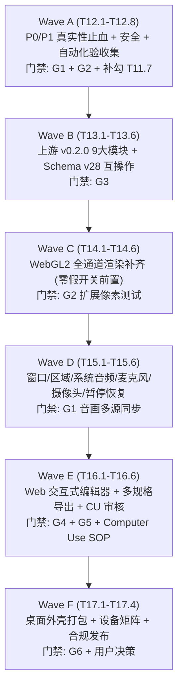

# DogSC Windows 重构总计划 V2（宏观 → 微观 · 低阶 Agent 可直接执行版）

> **文档版本**：v2.0（基于 2026-11-20 实机对齐审计报告定稿）  
> **适用仓库**：`F:\dogsc-win`（基线提交 `08a8392`，标签 `v0.3.0-phase3-render`）  
> **只读参考源码**：`F:\dogsc`（上游 `v0.1.8`，严禁修改）；Wave B 将另建只读克隆 `F:\dogsc-v0.2.0`（上游 `v0.2.0`）  
> **审计输入依据**：`C:\Users\HP\Doubao\chats\2026-11-20\new-chat-1\DogSC_Windows对齐审计与开发交接_2026-11-20.md`  
> **读者对象**：接手本项目的低成本 / 弱推理 Agent 模型（按卡机械执行，不自由发挥）及后续质量审核 Agent（含 Computer Use / Chrome DevTools MCP / 自动化像素检验脚本）

---

## 0. 审计基线与当前实测真相（先纠偏，再开工）

### 0.1 当前真实状态一句话结论
截至 `08a8392`，`F:\dogsc-win` 是一个**“旧版核心算法移植（44 模块 / Schema v27）+ 基础 CLI 采集 + 基础 WebGL2 渲染/导出”的工程原型**，**尚不是与 macOS `v0.2.0` 对齐的可交付 Windows 产品**。

虽然 `$env:DOGSC_E2E='1'; npm test` 已达 **204/204 通过**，但当前测试套件存在**严重的“伪全绿盲区”**（只查文件存在与函数不抛错，未查时长真实性、单光标、点击同帧、无效显示器退出码、Schema v28 兼容性）。因此：**严禁把当前 204 全绿当成阶段 3 完成或功能对齐证据！**

### 0.2 全量缺陷与缺口精确映射表（无一遗漏）

| 审计编号 | 严重级 | 实测现象 / 事实 | 代码精确根因（文件与行号） | 解决任务卡 |
|---|---|---|---|---|
| **P0-01** | P0 | 录制 `screen.mp4` 为 9.800s/588帧（历史 6.200s/372帧），`meta` 误写 12.377s（8.629s），导致 `export.mp4` 尾部冻结复帧 2.58s（2.43s） | `src/capture/RecordingSession.ts` L215 用 `Date.now() - screenStartUnixMs` 算时长；`scripts/export.ts` L91 直接信 `meta.durationSeconds`；`src/render/FramePlan.ts` L69 把超界源帧号夹到末帧 | **T12.1** |
| **P0-02** | P0 | `node scripts/record.ts --seconds 1 --fps 30 --display 9` 退出码 `0` 且打印“录制顺利完成”，但无 `screen.mp4` | `src/capture/ScreenRecorder.ts` `stop()` 不检查 `exitCode`/stderr；`RecordingSession.ts` 未校验产物与退出码就写 `meta`/`project` | **T12.2** |
| **P0-03** | P0 | 实测 `render_6_8.png` 同时存在 Windows 系统光标与 WebGL 矢量光标（双光标重影） | `src/capture/ScreenRecorder.ts` L50 `ddagrab` 未传 `draw_mouse=0`（默认 `true`）；`web/renderer.ts` L1228+ 又自绘矢量光标 | **T12.3** |
| **P0-04** | P0 | 本地仅覆盖上游 `v0.1.8` 的 44 模块与 Schema v27；上游 `v0.2.0` 有 53 模块与 Schema v28 | 缺失 `CameraBeauty`、`PostProductionModel`、`RecordingAspectTransitions`、`RecordingProjectImport`、`RecordingSource`、`RecordingSourceEditing`、`ScreenCardAppearance`、`SegmentSceneStyle`、`VisualTrackTransfer`；`ProjectModel.ts` L61 `currentVersion=27` | **T13.1–T13.6** |
| **P1-01** | P1 | 并发负载下导出曾卡死于 420/739；无超时保护，CLI 无限挂起 | `ExportServer.ts` L366 `waitForDone()` 无超时；`scripts/export.ts` L162 仅 race `earlyEdgeExit`；`web/exporter.ts` 无单帧超时/错误上报 | **T12.4** |
| **P1-02** | P1 | `/api/done` 不核对 `receivedFrames === plan.frameCount`，可静默产出残缺视频 | `src/server/ExportServer.ts` L279–295 直接 `stdin.end()` 返回 200 | **T12.4** |
| **P1-03** | P1 | 副屏 `--display 1` 录制时鼠标仍按主屏归一化，`meta.width/height` 错取主屏 | `tools/mousehook.ps1` L71 写死 `Screen.PrimaryScreen.Bounds`；`MouseHook.ts` 无显示器入参；`RecordingSession.ts` L176 读表头 bounds | **T12.5** |
| **P1-04** | P1 | `project.json` 恒写 `60fps`、`hevc`、`recordsSystemAudio=true`、`displayID=null`，与实录不符；且存在重复 `CaptureConfiguration` 英文假枚举 | `RecordingSession.ts` L94 `buildProjectFromRecording` 未传 `capture`；`ProjectMediaModel.ts` L72–102 存在未与 `CaptureConfiguration.ts` 统一的旧英文默认值 | **T12.6** |
| **P1-05** | P1 | `screenStartUnixMs` 采于 `spawn` 前，未扣除 ffmpeg/NVENC 启动延迟，无法保证点击与画面 ≤1 帧同步 | `ScreenRecorder.ts` L130 未解析首帧实际产出时刻；缺少闪帧同步测试卡 | **T12.7** |
| **P1-06** | P1 | `scripts/calibrate.ts` 仅打印点击数不硬断言，历史 `20261114-184749` 仅 1 次点击也被当验收通过 | `scripts/calibrate.ts` L89 无 `clicks.length === 2` 与时间窗断言及非 0 退出 | **T12.7** |
| **P1-07** | P1 | `DevServer`/`ExportServer` 使用 `startsWith(root)` 校验路径，可被同名前缀兄弟目录（如 `dogsc-win-evil`）绕过 | `ExportServer.ts` L302/L323、`DevServer.ts` L56 | **T12.8** |
| **P1-08** | P1 | 渲染器仅画背景/阴影/屏幕/光标涟漪，未消费 `FrameScene` 中的摄像头、贴纸、马赛克/聚光灯、设备外框、聚焦虚化、开场动画 | `web/renderer.ts` L1150–1310 | **T14.1–T14.6** |
| **P2-01~03** | P2 | 缺窗口/区域录制、系统音频/麦克风/混音、摄像头采集与同步、暂停/恢复与录制标记 | `src/capture/*` 仅支持 `ddagrab` 无声全屏 | **T15.1–T15.6** |
| **P2-04,08~10** | P2 | 缺 Web 编辑器 GUI、多轨时间线拖拽、剪切/变速 UI、参数调节、多规格导出（M4A / 1080p / 1440p / 4K / 多比例） | `web/` 仅有无交互的 `render.html` | **T16.1–T16.6** |
| **P2-11,12,14** | P2 | 缺桌面打包壳、设备矩阵实测、根 `LICENSE` 与第三方声明 | 根目录无 `LICENSE`、无安装包、缺硬件矩阵报告 | **T12.8** (License) + **T17.1–T17.4** |
| **P2-13** | P2 | `detectEncoder()` 仅查 `-encoders` 文本，未探活真实 GPU，无运行时编码回退 | `src/capture/ScreenRecorder.ts` L99–109 | **T12.3** |
| **P2-05~07** | P2 | 字幕（双语/SRT/动效）、素材箱/BGM 自动压低、AI/Codex/MCP 助手、iPhone/iPad 有线采集 | 属上游高阶扩展产品层，暂列 Wave G（需用户确认是否纳入范围） | **§7 决策门禁** |
| **P3-01~06** | P3 | `CONTRACTS.md` §6 过期、无根 `README.md`、Node 版本口径不一、`out/cu-e2e-testcard.html` 坐标文案偏差、`formatSessionId` 同秒冲突、`jsonlStream.end()` 未 await 落盘、脏录像混杂、T11.7 未验收 | 见各文档与 `RecordingSession.ts` L60/L212 | **T12.2 / T12.7 / T12.8** |

### 0.3 战略路线定调
- **默认执行路线 A（TypeScript 零依赖核心 + WebGL2 + 本地服务 + 渐进式桌面壳）**：最大化保留现有 44（即将升至 53）个纯算法模块与自动化测试资产，零外部运行黑盒风险。
- **不直接采用社区 `spring-it/dogsc`（WPF `windows-v0.1.21`）**：该 fork 停留在 2026-10-19、PR #19 `dirty` 未合并、安装包未签名、且其自身清单缺自动缩放/3D/完整时间线；仅可作为 Windows WASAPI/DirectShow 思路的外部参考，**严禁直接拷贝其代码或分发其未签名 exe**。
- **硬启动指令**：**必须先完成 Wave A（T12.1–T12.8）全部 P0/P1 修复并重新通过 T11.7 真实成片验收，再进入 Wave B–F；严禁跳过 Wave A 直接写 UI。**

---

## 1. 重构后最终产品蓝图与视觉/功能效果描述（Target State）

### 1.1 最终交付形态
重构完成后，`DogSC Windows` 是一款**与 macOS 上游 `v0.2.0` 算法和工程文件双向兼容、画面质感与流畅度达到原生级水准**的 Windows 10/11 屏幕录制与轻量化自动运镜编辑软件：

1. **端到端工作流**：一键选择源（整块屏幕 / 单个窗口 / 自选区域）+ 开关音频（系统声 / 麦克风）+ 开关摄像头 → 60fps 硬件加速录制（带实时暂停/恢复与标记点）→ 自动根据鼠标点击生成平滑缩放运镜工程（Schema v28）→ 打开交互式 WebGL2 编辑器实时预览、拖拽时间线/缩放片段/剪切变速/调画布样式 → 一键稳定导出 MP4 / M4A（1080p / 1440p / 4K，30 / 60fps，多画幅比例）。
2. **双模式运行**：
   - **纯本地零安装模式**（Wave A–E 即可用）：`node scripts/studio.ts` 启动本地服务并自动打开系统 Edge App 模式窗口（`msedge.exe --app=http://127.0.0.1:<port>/web/studio.html`），零 npm 依赖即可获得完整桌面级 GUI 体验。
   - **可安装桌面包模式**（Wave F，由用户选定壳层后实施）：打包为带图标、安装器、版本信息与合规许可证的 Windows 桌面应用。

### 1.2 六大核心功能与最终视觉效果验收标准

| 维度 | 最终必须达到的效果（供人工 & Computer Use 审核对照） |
|---|---|
| **1. 采集真实性与零重影** | ① `meta.durationSeconds`、`screen.mp4`、`export.mp4` 三者时长误差 **≤ 0.05 秒**，成片尾部零静止复帧；② 源视频关闭 OS 光标绘制（`draw_mouse=0`），成片全局**仅可见一只光滑的 DogSC 光标**，高速移动无双影；③ 点击时刻与画面响应误差 **≤ 1 帧（16.7ms）**；④ 无效显示器/设备缺失/编码器故障时立即以非 0 退出并清理脏目录，绝不假报成功；⑤ 多屏/副屏/负坐标/混合 DPI 下鼠标归一化精确命中目标中心。 |
| **2. 自动运镜与光标质感** | ① 点击时空聚类 + 18% 前摇 + 活跃延长 + 240Hz 弹簧（默认屏幕 `2.4/210/42`，光标 `2.8/450/66`）+ 五次平滑点击锚定，运动顺滑无抽搐；② 支持矢量箭头与自定义光标样式、速度微倾斜（7–9°）、闲置自动隐藏、4 种点击动效（涟漪/圆环/光点/组合）与颜色/透明度/缩放可调。 |
| **3. 全通道 WebGL2 视觉合成** | 严格按 `FrameScene.layerOrder` 渲染全部通道：① 背景（纯色/对角渐变/动态流光/黑曜石网格/点阵/图片模糊）；② 屏幕本体（3D 透视单应性投影、SDF 抗锯齿圆角与边框、3D 外扩柔和阴影、窗口/浏览器/手机/平板设备外框 Chrome、聚焦外围虚化）；③ 屏幕遮罩特效（马赛克/像素化/模糊、聚光灯高亮压暗）；④ 摄像头画中画（镜像/AspectFill、圆角/圆形遮罩、缩放联动避让、平滑出场/退场动画、阴影边框）；⑤ 贴纸与接力转场（含背景模糊遮罩防穿帮）；⑥ 开场 3D 序列动画。 |
| **4. 音视频多轨采集与同步** | ① 整屏（`ddagrab` GPU）、自选区域（`ddagrab` `offset_x/offset_y/video_size` GPU）、单窗口（`gdigrab` + `draw_mouse=0`）；② 系统音频（零依赖 PowerShell WASAPI Loopback 录 WAV）+ 麦克风（DirectShow）+ 多轨音量独立调节与混音进 MP4/M4A；③ 摄像头（DirectShow 独立 `camera.mp4` + 同步锚点）；④ 录制中热键打标记点（`RecordingMarker`）与暂停/恢复拼接。 |
| **5. 交互式编辑器（零假开关）** | ① 所见即所得 WebGL2 实时预览画布（与导出共用同一套 `FrameSceneEvaluator` + 着色器，逐像素一致）；② 底部多轨时间线（主视频片段拆分/左右裁切/移动重排/删除恢复/倍速、缩放片段拖拽与缩放手柄、马赛克/贴纸/摄像头运动轨道、播放头拖动与磁吸吸附、标记点可视化）；③ 右侧属性检查器（画布比例、留白、圆角、阴影、背景预设、设备框、光标样式、弹簧预设、音频音量）与 Undo/Redo 栈；④ **严禁出现“界面上有按钮但渲染器未实现”的假开关**。 |
| **6. 导出稳定性与上游互通** | ① 严格顺序与总帧数校验（缺 1 帧即报 409 并删残片）；② 30s 无帧 Watchdog + 单帧超时重试 + 页面异常 `/api/error` 秒级熔断 + 退出必杀孤儿 Edge/ffmpeg；③ 恒定 O(1) 浏览器内存（`ImageBitmap.close()` + 响应体消费），支持 30 分钟长视频不 OOM；④ 支持导出 MP4 (H.264/HEVC) 与 M4A、原始/1080p/1440p/4K、30/60fps、多比例；⑤ 完整覆盖上游 `v0.2.0` 53 个核心模块，支持无损读写 Schema v28 工程并向下兼容读取 v27（保留未知字段）。 |

### 1.3 明确非目标（Wave A–F 不做，防止低阶 Agent 越界）
以下上游高阶特性划入 **Wave G（待用户确认扩展）**，在 Wave A–F 中**禁止实现，禁止在 UI 留占位按钮**：
- 有线 iPhone/iPad 投屏采集（依赖 Apple MobileDevice / QuickTime 私有驱动）；
- 双语语音转写字幕 / Rive 动效引擎；
- 内置 AI 助手 / Codex / MCP 项目编辑器；
- 独立素材商店 / 背景音乐库与智能闪避（自动压低）。

---

## 2. 升级版架构契约（CONTRACTS V2，低阶 Agent 严禁擅改）

> 任何与以下契约冲突的代码都是缺陷。若实现中发现契约本身存在矛盾，**必须停下并在 `docs/PROGRESS.md` 写入 `NEED-DECISION: <原因>`**，交由高阶 AI 裁决。

### C0. 目录与依赖硬边界
- `src/core/`、`src/render/`、`web/`：**绝对禁止 `import 'node:*'`**（两端共享，浏览器直接运行）。
- `src/capture/`、`src/server/`、`scripts/`：仅 Node 运行，可使用 `node:*` 内置模块。
- Wave A–E **零 npm 外部依赖**；外部可执行文件仅限 `ffmpeg`、`ffprobe`、`powershell.exe` (5.1)、`msedge.exe`。
- **绝对禁止 `-ExecutionPolicy Bypass`** 或任何策略绕过参数。
- **`F:\dogsc` 只读禁改**；Wave B 另建只读克隆 `F:\dogsc-v0.2.0` 亦只读禁改。

### C1. 媒体探测与录制时长唯一真相（修 P0-01）
- 新增 `src/capture/MediaProbe.ts`，提供：
  - `parseFfprobeJson(stdout: string): ProbedVideoInfo`（纯函数，单测全覆盖）
  - `probeMediaFile(filePath: string): Promise<ProbedVideoInfo>`（调用 `ffprobe -v error -select_streams v:0 -show_entries format=duration,size -show_entries stream=codec_name,width,height,nb_frames,r_frame_rate,avg_frame_rate,start_time -of json <filePath>`，超时 10s）。
- `ProbedVideoInfo = { durationSeconds: number; frameCount: number; width: number; height: number; fps: number; codecName: string; startTimeSeconds: number; sizeBytes: number }`。
- **强制不变量**：
  - `RecordingSession.ts` 在 `recorder.stop()` 成功后**必须**调用 `probeMediaFile(screenMp4Path)`；若 `ffprobe` 失败、`durationSeconds <= 0` 或 `frameCount <= 0`，必须抛出错误，**禁止回退到 `Date.now()` 墙钟时间**。
  - `meta.json` 必须写入真实 `durationSeconds`、`frameCount`、`width`、`height`（均来自 `ffprobe`），并保留诊断字段 `spawnUnixMs`、`firstFrameUnixMs`。
  - `FramePlan.ts`：令 `effectiveSourceDuration = sourceFrameCount > 0 ? Math.min(safeDuration, sourceFrameCount / safeFps) : safeDuration`，以 `effectiveSourceDuration` 构造 `TimelineMap` 与 `OutputFrameSchedule`，确保 1x 全段导出的 `frameCount === sourceFrameCount`，绝不出现尾部复帧。

### C2. 采集失败即失败与原子清理（修 P0-02, P3-04）
- `ScreenRecorderHandle` 新增 `exited: Promise<{ code: number | null; stderr: string }>` 与 `ready: Promise<{ firstFrameUnixMs: number }>`。
- `ScreenRecorder.stop()` 在 ffmpeg 退出码 `!== 0`、spawn 报错或被强杀时**必须 reject**，错误消息附带最后 500 字符的 `stderr`（如 `Failed to enumerate DXGI output`）。
- `recordSession()` 必须用 `Promise.race([sleep, recorder.exited])` 监控早期崩溃；任何环节失败时必须停止双方子进程、await `jsonlStream` 关闭、**删除不完整的 `sessionDir`**（禁止留下缺少 `screen.mp4` 的伪成功目录），并让 `scripts/record.ts` 以退出码 `1` 结束。
- `formatSessionId()` 保留 `YYYYMMDD-HHmmss` 主格式；若同秒目录已存在则追加 `-<序号>`（如 `-01`）避免覆写。
- `jsonlStream.end()` 后必须 `await finished(jsonlStream)` 确保完全落盘再读取/返回。

### C3. 单光标与运行时编码器探活（修 P0-03, P2-13）
- `buildFfmpegArgs` 的 `ddagrab` 滤镜字符串默认必须包含 `:draw_mouse=0`（格式：`ddagrab=output_idx=${outputIdx}:framerate=${fps}:draw_mouse=0`）；区域采集追加 `:video_size=${w}x${h}:offset_x=${x}:offset_y=${y}`；`gdigrab` 窗口采集必须包含 `-draw_mouse 0`。
- `detectEncoder()` 必须通过 1 帧空输出探活验证（`ffmpeg -hide_banner -f lavfi -i color=c=black:s=256x256:d=0.04 -frames:v 1 -c:v h264_nvenc -f null -`，超时 3s），退出码为 0 才返回 `'h264_nvenc'`，否则回退 `'libx264'`。

### C4. 首帧时钟对齐契约（修 P1-05）
- `buildFfmpegArgs` 增加 `'-progress', 'pipe:1', '-stats_period', '0.05'`，由 `ScreenRecorder.ts` 解析 stdout 中首次出现的 `frame=<N>`（`N >= 1`）与 `out_time_us=<U>`，计算 `firstFrameUnixMs = Math.round(Date.now() - U / 1000)` 并 resolve `recorder.ready`。
- `recordSession` 必须先 `await Promise.race([recorder.ready, recorder.exited])`，再开始录制时长倒计时。
- `pointerOffsetSeconds = (pointerOriginUnixMs - firstFrameUnixMs) / 1000`。

### C5. 统一显示器描述符与混合 DPI（修 P1-03）
- 新增 `src/capture/DisplayEnumeration.ts`，导出 `DisplayDescriptor = { index: number; deviceName: string; isPrimary: boolean; x: number; y: number; width: number; height: number }`、`parseDisplaysJson(stdout)`、`enumerateDisplays()`。
- `tools/mousehook.ps1` 必须：
  1. 顶部声明 `param([int]$ScreenX = 0, [int]$ScreenY = 0, [int]$ScreenW = 0, [int]$ScreenH = 0)`；
  2. 优先调用 `SetProcessDpiAwarenessContext((IntPtr)(-4))`（`PER_MONITOR_AWARE_V2`），失败回退 `SetProcessDPIAware()`；
  3. 若 `$ScreenW -gt 0 -and $ScreenH -gt 0`，表头 `screen` 写该矩形，否则写主屏物理矩形。
- `recordSession` 通过 `outputIdx` 查找唯一 `DisplayDescriptor`，同步传给 `MouseHook`、`ScreenRecorder`、`meta` 与 `project.capture`。若 `outputIdx` 超出已枚举显示器范围且非测试注入，立即抛错。

### C6. 真实 `CaptureConfiguration` 单源化（修 P1-04）
- 删除 `src/core/ProjectMediaModel.ts` 内重复的 `CaptureConfiguration` 接口与英文假默认值，统一从 `./CaptureConfiguration.ts` 导入并 re-export（使用 Swift 原生 rawValue：`'整块屏幕'`、`'H.264'`、`'HEVC'`、`'原始分辨率'`、`'全部系统声音'`）。
- 在 `decodeRecorderProject` 中保留旧英文字符串向中文 rawValue 的向后兼容映射（`'display'→'整块屏幕'`, `'h264'→'H.264'`, `'hevc'→'HEVC'`, `'native'→'原始分辨率'`, `'all'→'全部系统声音'`），避免旧测试或旧项目报错。
- `recordSession` 调用 `buildProjectFromRecording` 时必须传入本次会话的真实 `captureConfig`：`captureFrameRate = fps`、`captureCodec = 'H.264'`、`recordsSystemAudio = Boolean(o.recordSystemAudio)`（Wave A 默认 `false`）、`recordsMicrophone = Boolean(o.recordMicrophone)`、`recordsCamera = Boolean(o.recordCamera)`、`displayID = outputIdx`、`displayName = display.deviceName`。

### C7. 导出服务 Watchdog、总帧数强校验与错误回传（修 P1-01, P1-02）
- `ExportServerOptions` 新增 `inactivityTimeoutMs?: number`（默认 `30_000`）、`totalTimeoutMs?: number`（默认 `Math.max(120_000, plan.frameCount * 500)`）。
- 收到每个合法 `POST /api/frame/:n` 时重置 inactivity timer；超时触发则强杀 ffmpeg、清理半成品 `outFile`、reject `donePromise`。
- 新增 `POST /api/error`：接收 `{ message: string; frameIndex?: number }`，立即终止导出、清理半成品并 reject `donePromise`，返回 `200`。
- `POST /api/done` **必须校验 `expectedFrame === o.plan.frameCount`**：不相等时强制结束 ffmpeg、删除半成品 `outFile`、reject `donePromise` 并返回 HTTP `409 Conflict`（body 写明 `expected` 与 `received`）。
- `web/exporter.ts`：单帧 `fetch` 附带 `AbortController` 超时（15s），网络异常重试最多 2 次（遇到 400/409 不重试直接抛错）；最外层 `catch` 尽力发送 `POST /api/error` 后再抛出。
- `scripts/export.ts` `finally` 块中，若 `edge.pid` 仍存活，使用 `taskkill /F /T /PID <pid>` 清理整个 Edge 进程树（含 GPU/渲染子进程），绝不留孤儿进程。

### C8. 路径安全边界（修 P1-07）
- 新增 `src/server/SafePath.ts`，导出纯函数 `resolveSafeChildPath(rootDir: string, relativeOrUrlPath: string): string | null`：
  - 规范化根路径与目标路径，计算 `const rel = path.relative(resolvedRoot, resolvedTarget)`；
  - 若 `rel === '..' || rel.startsWith('..' + path.sep) || path.isAbsolute(rel)` 返回 `null`。
- `DevServer.ts` 与 `ExportServer.ts` 全部改用 `resolveSafeChildPath`，严禁出现 `.startsWith(rootDir)`。

### C9. 上游 `v0.2.0` 与 Schema v28 兼容契约（修 P0-04）
- 克隆 `https://github.com/laogou717/dogsc` tag `v0.2.0` 到只读目录 `F:\dogsc-v0.2.0`。
- 按 `PORTING_RULES.md` 1:1 补齐 9 个缺失 Swift 模块，并对比原有 44 个文件在 `v0.1.8..v0.2.0` 间的 diff 逐项同步。
- `ProjectSchema.currentVersion` 升至 `28`，`minimumSupportedVersion` 维持 `23`。
- 读取策略：无损解码 v23–v28；解码 v27 时自动迁移补齐 v28 的 `recordingSources` / source-aware 字段；遇到当前 TS 模型未认识的额外 JSON 字段，保存在非破坏性 `unknownFields?: Record<string, unknown>` 并在 `encodeRecorderProject` 时原样回写（未知字段零静默丢失）。

### C10. WebGL2 全通道渲染契约（修 P1-08）
- `web/renderer.ts` 拆分为模块化渲染通道（全部零 `node:*` 依赖，在 `web/passes/` 下拆分，避免单文件膨胀超 2000 行）：
  1. `web/passes/background.ts`：纯色、渐变、光晕、网格/点阵/等角流光、自定义背景图与模糊；
  2. `web/passes/screen.ts`：3D 阴影、设备/窗口/浏览器外框 Chrome（`scene.screen.chrome`）、透视投影屏幕（圆角+边框）、焦点虚化（`scene.screen.focus`）、马赛克像素化/模糊（`scene.screen.mosaics`）；
  3. `web/passes/cursor.ts`：4 种点击涟漪动效 + 矢量/自定义光标材质 + 阴影/倾斜/点击缩放；
  4. `web/passes/spotlight.ts`：全局聚光灯压暗与高亮镂空（`scene.screen.mosaics` 中 spotlight 类型）；
  5. `web/passes/camera.ts`：摄像头帧纹理（独立 `camera_frames/%06d.jpg`）、AspectFill + 水平镜像、圆角/圆形 SDF 遮罩、边框与阴影、出场动画；
  6. `web/passes/stickers.ts`：贴纸背景模糊遮罩（`scene.stickerBackdrop`）+ 贴纸图层（圆角、边框、阴影、旋转、透明与接力进度）。
- 主渲染器严格按 `scene.layerOrder` 依次调度；当某通道在当前帧无元素（如 `camera === null`、`stickers.length === 0`）时零 draw call、零黑块。

### C11. 交互式编辑器本地服务契约（Wave E）
- 新增 `src/server/StudioServer.ts`（复用 `DevServer` 类型擦除 + `SafePath`）：
  - `GET /api/recordings`：列出 `recordings/` 下有效会话（仅列出包含合法 `meta.json` + `screen.mp4` + `project.json` 的目录，自动过滤脏目录）；
  - `GET /api/recordings/:id/project`、`PUT /api/recordings/:id/project`：读取与校验后原子保存（先写 `.tmp` 再 `rename`）`project.json`；
  - `POST /api/recordings/:id/prepare-frames`：按需触发 `extractFrames`（支持主屏幕与可选摄像头）；
  - `POST /api/recordings/:id/export`、`GET /api/export/:jobId`：启动后台导出任务并返回实时帧进度/错误/输出文件路径。

---

## 3. 宏观分波路线图与阶段门禁（Wave A → Wave F）



| 波次 | 任务卡范围 | 核心产出 | 进入下一波的前置硬门禁 |
|---|---|---|---|
| **Wave A** | `T12.1`–`T12.8` | 修复全部已实测 P0-01/02/03 与 P1-01~07；建成闪帧测试卡与 `verify-export.ts` 自动化像素验收集 | 实机重录+导出通过 **G1+G2**；用户肉眼复核无双光标无尾帧冻结 → **正式勾选 `T11.7` 并写“阶段 3 完成”** |
| **Wave B** | `T13.1`–`T13.6` | `src/core` 44 → 53 模块；`ProjectSchema` 27 → 28；v27/v28 双向 Golden Fixture 测试通过 | 通过 **G3**（上游 v0.2.0 fixture 无损 decode/encode） |
| **Wave C** | `T14.1`–`T14.6` | `web/passes/*` 全通道渲染器（摄像头/贴纸/马赛克/聚光灯/设备框/聚焦虚化/开场/光标素材） | 每个通道均有独立 headless Edge 截图 + 像素断言测试通过 |
| **Wave D** | `T15.1`–`T15.6` | 区域/窗口录制、WASAPI Loopback 系统音频、DirectShow 麦克风与混音、摄像头同步录制、标记与暂停恢复 | 音画同步误差 ≤ 40ms，摄像头同步误差 ≤ 2 帧，`project.capture` 100% 真实 |
| **Wave E** | `T16.1`–`T16.6` | `StudioServer` + `web/studio.html` 完整交互编辑器 + 多规格导出（M4A / 1080p / 1440p / 4K / 多比例） | 通过 **G4+G5** 及 §6 Computer Use / Browser MCP 全流程 UI 审核 |
| **Wave F** | `T17.1`–`T17.4` | 桌面应用外壳（Electron / Tauri / WebView2 需用户选型）、硬件设备矩阵验证、发布打包 | 用户拍板打包方案 + 通过 **G6** + MIT/第三方声明齐全 |

---

## 4. 微观任务卡全集（T12.1 ～ T17.4 · 一卡一提交一中文标签）

> **低阶 Agent 执行须知**：每次**只执行一张卡**。严格遵守卡片的「允许改动文件」「精确改动」「必测项」「验证命令」「提交与标签」。若某张卡的必测项连续 3 次修不通，立即按 §5.3 写 `BLOCKED` 停止，**绝不偷偷修改测试期望值或跳过断言**。

---

### Wave A：P0/P1 真实性止血、安全加固与可信验收基建（立即开工）

#### T12.1 — 修复录制时长口径与导出尾部复帧（P0-01）
- **依赖**：无（当前 HEAD `08a8392` 直接起手）
- **允许改动文件**：
  - 新增 `src/capture/MediaProbe.ts`
  - 新增 `test/capture/MediaProbe.test.ts`
  - 修改 `src/capture/RecordingSession.ts`、`test/capture/RecordingSession.test.ts`
  - 修改 `src/render/FramePlan.ts`、`test/render/FramePlan.test.ts`
  - 修改 `scripts/export.ts`
- **精确改动规格**：
  1. 新建 `src/capture/MediaProbe.ts`：
     - 导出 `ProbedVideoInfo` 接口（`durationSeconds`, `frameCount`, `width`, `height`, `fps`, `codecName`, `startTimeSeconds`, `sizeBytes`）。
     - 导出纯函数 `parseFfprobeJson(stdout: string): ProbedVideoInfo`：解析 `streams[0]` 与 `format`；优先取 `streams[0].duration` 回退 `format.duration`；`fps` 解析 `r_frame_rate`（如 `"60/1"`）或 `avg_frame_rate`；`frameCount` 优先取正整数 `Number(streams[0].nb_frames)`，缺失时按 `Math.round(durationSeconds * fps)` 计算；若 `durationSeconds <= 0` 或非有限数或 `width <= 0` 或 `height <= 0` 或 `frameCount <= 0` 直接 `throw new Error(...)`。
     - 导出 `probeMediaFile(filePath: string): Promise<ProbedVideoInfo>`：通过 `execFile('ffprobe', ['-v', 'error', '-select_streams', 'v:0', '-show_entries', 'format=duration,size', '-show_entries', 'stream=codec_name,width,height,nb_frames,r_frame_rate,avg_frame_rate,start_time', '-of', 'json', filePath], { timeout: 10_000 })` 调用 `parseFfprobeJson`。
  2. 修改 `src/capture/RecordingSession.ts`：
     - `RecordingMetaInput` 与 `RecordingMeta` 增加可选/必选 `frameCount?: number`（`recordSession` 中必写）。
     - 删除第 215 行用 `Date.now() - recorder.screenStartUnixMs` 算时长的逻辑；改为在 `recorder.stop()` 后调用 `const probed = await probeMediaFile(screenMp4Path)`，用 `probed.durationSeconds`、`probed.frameCount`、`probed.width`、`probed.height` 写入 `meta.json` 并传入 `buildProjectFromRecording`。若 `probeMediaFile` 抛错，不得捕获降级为墙钟时间！
  3. 修改 `src/render/FramePlan.ts`：
     - 第 46 行后增加：`const maxSourceDuration = i.sourceFrameCount > 0 ? i.sourceFrameCount / safeFps : safeDuration;`
     - 令 `const effectiveDuration = Math.min(safeDuration, maxSourceDuration);`（当 `sourceFrameCount > 0` 时防止时间轴超过真实源视频时长）。用 `effectiveDuration` 创建 `schedule` 与 `timelineMap`。
  4. 修改 `scripts/export.ts`：
     - 第 91 行改为调用 `probeMediaFile(path.join(recDir, 'screen.mp4'))`，取 `const trueDuration = Math.min(probed.durationSeconds, sourceFrameCount / fps)`，并用 `makeOutputFrameSchedule(trueDuration, fps as OutputFrameRate)` 计算 `frameCount`；同时在传给 `ExportServer` 的 `plan.durationSeconds` 写入 `trueDuration`。
- **必测项**：
  1. `MediaProbe.test.ts`：正常 `ffprobe` JSON 解析、`nb_frames` 缺失回退、`duration=0`/非法 JSON/缺视频流必须抛错。
  2. `FramePlan.test.ts`：新增测试——传入 `durationSeconds: 12.377, fps: 60, sourceFrameCount: 588`（复现 `20261120-140843`），断言 `plan.frameCount === 588`（绝不是 743），末帧时间 `< 9.80` 秒。
  3. `RecordingSession.test.ts`：E2E 用例中校验 `Math.abs(meta.durationSeconds - probed.durationSeconds) <= 0.05` 且 `meta.frameCount === probed.frameCount`。
- **验证命令**：`cd F:\dogsc-win; npm test` → 全绿无报错。
- **Git 提交与标签**：
  - Commit: `fix(capture): 使用ffprobe真实视频时长与帧数消除导出尾部复帧 (T12.1)`
  - Tag: `T12.1-真实时长口径与去尾帧冻结`

#### T12.2 — 采集失败即失败、早期崩溃快速中止与会话落盘原子化（P0-02, P3-04）
- **依赖**：`T12.1`
- **允许改动文件**：
  - 修改 `src/capture/ScreenRecorder.ts`、`test/capture/ScreenRecorder.test.ts`
  - 修改 `src/capture/RecordingSession.ts`、`test/capture/RecordingSession.test.ts`
  - 修改 `scripts/record.ts`
- **精确改动规格**：
  1. 修改 `src/capture/ScreenRecorder.ts`：
     - `ScreenRecorderOptions` 新增可选 `ffmpegBin?: string`（默认 `'ffmpeg'`，便于单测注入假命令模拟非 0 退出）。
     - 监听 `proc.stderr` 累积尾部最多 16KB；监听 `proc.on('error')` 与 `proc.on('close', code)`，构造 `exited: Promise<{ code: number | null; stderr: string }>` 暴露在 `ScreenRecorderHandle`。
     - `stop()` 等待 `close` 完成（超时强杀标记 `timedOut = true`）；若 `spawnError` 存在、或 `timedOut`、或 `code !== 0`，`stop()` **必须 reject** 并包含 stderr 尾部 500 字符！
  2. 修改 `src/capture/RecordingSession.ts`：
     - `formatSessionId` 保持不变，新增 `allocateUniqueSessionDir(baseDir: string, id: string): string`：若目录已存在则依次尝试 `${id}-01`..`${id}-99`，避免同秒冲突（P3-04）。
     - 录制等待阶段用 `await Promise.race([sleep(seconds), recorder.exited.then((r) => { if (r.code !== 0) throw new Error(...); })])` 实现秒级失败熔断。
     - 将启动钩子、启动录屏、停止、等待 `await finished(jsonlStream)`、`probeMediaFile`、写 `meta`/`project` 包入 `try / catch`；在 `catch` 中确保 `hook.stop()`、`recorder.stop().catch(() => {})`、关闭流并执行 `rmSync(sessionDir, { recursive: true, force: true })` 清理脏目录，然后重新抛出原始错误。
  3. 检查 `scripts/record.ts`：确保 `catch` 分支打印明确错误信息并以 `process.exit(1)` 退出。
- **必测项**：
  1. `ScreenRecorder.test.ts`：用假命令（`node -e "console.error('Failed to enumerate DXGI output 9'); process.exit(1)"`）启动 `startScreenRecording`，断言 `stop()` reject 且错误信息包含 `Failed to enumerate DXGI output 9`。
  2. `RecordingSession.test.ts`：测试 `allocateUniqueSessionDir` 同秒不冲突；E2E 增加无效 `--display 9` 回归测试（或在单测用注入失败 ffmpeg），断言 `recordSession` reject 且 `sessionDir` 已被清理不存在。
- **验证命令**：
  - `cd F:\dogsc-win; npm test`
  - 交互桌面复测：`node scripts/record.ts --seconds 1 --fps 30 --display 9; echo "EXIT=$LASTEXITCODE"` → `EXIT=1`，stderr 含 `Failed to enumerate DXGI output`，且 `recordings/` 无新增无 `screen.mp4` 脏目录。
- **Git 提交与标签**：
  - Commit: `fix(capture): 强制校验ffmpeg退出码与产物完整性并原子清理失败目录 (T12.2)`
  - Tag: `T12.2-采集失败即失败与原子清理`

#### T12.3 — 关闭 `ddagrab` 系统光标烘焙（消除双光标）与编码器真机探活（P0-03, P2-13）
- **依赖**：`T12.2`
- **允许改动文件**：
  - 修改 `src/capture/ScreenRecorder.ts`、`test/capture/ScreenRecorder.test.ts`
- **精确改动规格**：
  1. `FfmpegArgsOptions` 与 `ScreenRecorderOptions` 新增可选 `drawMouse?: boolean`（默认 `false`）。
  2. `buildFfmpegArgs` 第 50 行改为：
     `` `ddagrab=output_idx=${outputIdx}:framerate=${fps}:draw_mouse=${o.drawMouse ? 1 : 0}` ``
  3. 升级 `detectEncoder()`：
     - 先查 `ffmpeg -hide_banner -encoders` 是否含 `h264_nvenc`；
     - 若包含，再执行 1 帧空输出真机探活：`execFileAsync('ffmpeg', ['-hide_banner', '-loglevel', 'error', '-f', 'lavfi', '-i', 'color=c=black:s=256x256:d=0.04', '-frames:v', '1', '-c:v', 'h264_nvenc', '-f', 'null', '-'], { timeout: 3000 })`；
     - 仅探活成功（exit 0）返回 `'h264_nvenc'`，任何异常静默回退 `'libx264'`。
  4. 按新契约 `CONTRACTS.md §3` 更新 `test/capture/ScreenRecorder.test.ts` L27 与 L62 的输入字符串断言（追加 `:draw_mouse=0`），并新增 `drawMouse: true` 时生成 `:draw_mouse=1` 的单测。
- **必测项**：默认参数必含 `:draw_mouse=0`；`drawMouse: true` 含 `:draw_mouse=1`；`detectEncoder` 返回有效编码器且在模拟无 NVENC 时回退 `libx264`。
- **验证命令**：`cd F:\dogsc-win; npm test`
- **Git 提交与标签**：
  - Commit: `fix(capture): 默认关闭ddagrab系统光标绘制消除双光标并增加NVENC探活回退 (T12.3)`
  - Tag: `T12.3-单光标消除重影与编码探活`

#### T12.4 — 导出 Watchdog、总帧数强校验、页面异常秒报与 Edge 进程树清理（P1-01, P1-02）
- **依赖**：`T12.1`
- **允许改动文件**：
  - 修改 `src/server/ExportServer.ts`、`test/server/ExportServer.test.ts`
  - 修改 `web/exporter.ts`
  - 修改 `scripts/export.ts`
- **精确改动规格**：
  1. `src/server/ExportServer.ts`：
     - `ExportServerOptions` 新增 `inactivityTimeoutMs?: number`（默认 `30_000`）与 `totalTimeoutMs?: number`（默认 `Math.max(120_000, o.plan.frameCount * 500)`）。
     - 启动两个定时器：每次收到合法 `POST /api/frame/:n` 重置 `inactivityTimer`；触发任一超时立即清理定时器、终止 ffmpeg、若非假命令则删除半成品 `outFile`、reject `donePromise`。
     - 新增 `POST /api/error`：解析 JSON `{ message, frameIndex }`，立即终止 ffmpeg、清理半成品、reject `donePromise(new Error(...))`，返回 `200`。
     - 修改 `POST /api/done`：若 `expectedFrame !== o.plan.frameCount`，设 `doneCalled = true`，强杀 ffmpeg，删除半成品 `outFile`，reject `donePromise(new Error(\`Incomplete export: expected ${o.plan.frameCount} frames, received ${expectedFrame}\`))`，并返回 HTTP `409 Conflict`！
     - 成功或 `close()` 时务必 `clearTimeout` 所有定时器（防止 Node 测试进程挂起）。
  2. `web/exporter.ts`：
     - `runExportLoop` 新增可选 `options?: { frameTimeoutMs?: number; maxRetries?: number }`（默认 `15_000`, `2`）。
     - 单帧 `fetch` 使用 `AbortController` 实现 `frameTimeoutMs` 超时；网络错误或超时最多重试 `maxRetries` 次；HTTP `400`/`409` 不重试立即抛错。
     - 外层 `try / catch`：捕获异常后 `await fetch('/api/error', { method: 'POST', headers: { 'Content-Type': 'application/json' }, body: JSON.stringify({ message: String(err), frameIndex: currentFrame }) }).catch(() => {})` 再重新抛出。
  3. `scripts/export.ts`：
     - `finally` 中除 `edge.kill('SIGKILL')` 外，若 `process.platform === 'win32' && edge.pid`，调用 `spawnSync('taskkill', ['/F', '/T', '/PID', String(edge.pid)], { stdio: 'ignore' })` 清理 Edge 整个进程树。
- **必测项**（`ExportServer.test.ts` 新增 3 个负向测试）：
  1. 计划 3 帧、仅发 1 帧就 `POST /api/done` → 返回 `409`，`waitForDone()` reject，且不残留输出文件。
  2. 设置 `inactivityTimeoutMs: 150` 且不发任何帧 → `waitForDone()` 在 500ms 内 reject 且错误信息含 `inactivity timeout`。
  3. 客户端发 `POST /api/error` `{ message: "WebGL context lost", frameIndex: 2 }` → 返回 `200` 且 `waitForDone()` 立即 reject 含该错误信息。
- **验证命令**：`cd F:\dogsc-win; npm test`
- **Git 提交与标签**：
  - Commit: `fix(export): 增加导出无帧看门狗、总帧数强校验与浏览器错误上报 (T12.4)`
  - Tag: `T12.4-导出看门狗与总帧数校验`

#### T12.5 — 统一显示器描述符与混合 DPI 多屏鼠标映射（P1-03）
- **依赖**：`T12.2`
- **允许改动文件**：
  - 新增 `src/capture/DisplayEnumeration.ts`、`test/capture/DisplayEnumeration.test.ts`
  - 修改 `tools/mousehook.ps1`
  - 修改 `src/capture/MouseHook.ts`、`test/capture/MouseHook.test.ts`
  - 修改 `src/capture/RecordingSession.ts`
- **精确改动规格**：
  1. 新建 `src/capture/DisplayEnumeration.ts`：
     - 导出 `DisplayDescriptor = { index: number; deviceName: string; isPrimary: boolean; x: number; y: number; width: number; height: number }`。
     - 导出纯函数 `parseDisplaysJson(stdout: string): DisplayDescriptor[]`：支持单对象或数组 JSON，将主屏排在 index 0（或保留显式 `index`），支持负坐标（如 `x: -1920`）。
     - 导出 `enumerateDisplays(): Promise<DisplayDescriptor[]>`：运行无 Bypass 的 PowerShell 一行脚本（先调用 `SetProcessDpiAwarenessContext(-4)`/`SetProcessDPIAware()` 再枚举 `[System.Windows.Forms.Screen]::AllScreens` 转 `ConvertTo-Json`）。
  2. 修改 `tools/mousehook.ps1`：
     - 顶部加入 `param([int]$ScreenX = 0, [int]$ScreenY = 0, [int]$ScreenW = 0, [int]$ScreenH = 0)`。
     - C# 类新增 `SetProcessDpiAwarenessContext(IntPtr value)` P/Invoke，优先传 `new IntPtr(-4)`（Per-Monitor V2），失败回退 `SetProcessDPIAware()`。
     - `Run(int sx, int sy, int sw, int sh)`：当 `sw > 0 && sh > 0` 时使用 `(sx, sy, sw, sh)` 写表头，否则回退 `Screen.PrimaryScreen.Bounds`。
  3. 修改 `src/capture/MouseHook.ts`：
     - `buildMouseHookCommand(options?: { scriptPath?: string; screenBounds?: { x: number; y: number; w: number; h: number } })`（兼容旧 `string` 重载！）：当传入 `screenBounds` 时追加 `'-ScreenX', String(x), '-ScreenY', String(y), '-ScreenW', String(w), '-ScreenH', String(h)`，依然禁止出现任何 Bypass 参数。
  4. 修改 `src/capture/RecordingSession.ts`：
     - `RecordSessionOptions` 允许注入 `displays?: DisplayDescriptor[]`（方便单测）。
     - 启动前枚举显示器并按 `outputIdx` 查找对应 `DisplayDescriptor`；若索引越界直接抛错；将同一 `screenBounds` 传给 `startMouseHook` 并记录 `displayDescriptor` 到 `meta.json`。
- **必测项**：
  1. `DisplayEnumeration.test.ts`：测试双屏负坐标（左侧副屏 `x=-1920, y=0, w=1920, h=1080`）、主屏排序、4K 混合 DPI 物理像素解析，以及配合 `parsePointerJsonl` 验证点击副屏 `(-1820, 100)` 归一化为 `(100/1920, 100/1080)`。
  2. `MouseHook.test.ts`：验证带 `screenBounds` 生成 `-ScreenX -1920 ...` 且无 Bypass。
- **验证命令**：`cd F:\dogsc-win; npm test`
- **Git 提交与标签**：
  - Commit: `feat(capture): 统一多显示器描述符与Per-Monitor DPI感知鼠标映射 (T12.5)`
  - Tag: `T12.5-多显示器描述符与DPI映射`

#### T12.6 — 统一 `CaptureConfiguration` 并真实写入 `project.json`（P1-04）
- **依赖**：`T12.5`
- **允许改动文件**：
  - 修改 `src/core/ProjectMediaModel.ts`
  - 修改 `src/capture/RecordingSession.ts`、`test/capture/RecordingSession.test.ts`
  - 修改 `test/core/ProjectMediaModel.test.ts`（如存在，补充向后兼容解码用例）
- **精确改动规格**：
  1. `src/core/ProjectMediaModel.ts`：
     - 移除第 40–102 行重复定义的 `CaptureConfiguration` 接口与英文假默认值 `makeCaptureConfiguration`；改为从 `./CaptureConfiguration.ts` 导入 `CaptureConfiguration`、`makeCaptureConfiguration` 并 `export` 出去。
     - 在 `decodeRecorderProject` 中对旧英文值做兼容归一化：
       - `source`: `'display' → '整块屏幕'`, `'window' → '单个窗口'`, `'area' → '自选区域'`, `'device' → 'iOS 设备'`
       - `captureCodec`: `'hevc' → 'HEVC'`, `'h264' → 'H.264'`, `'proRes422' → 'ProRes 422'`
       - `captureResolutionLimit`: `'native' → '原始分辨率'`, `'uhd' → '最高 4K'`, `'fullHD' → '最高 1080p'`
       - `systemAudioScope`: `'all' → '全部系统声音'`, `'selectedApplication' → '所选窗口 App'`
  2. `src/capture/RecordingSession.ts`：
     - `buildProjectFromRecording(events, offsetSeconds, durationSeconds, captureOptions?: Partial<CaptureConfiguration>)` 将 `makeCaptureConfiguration(captureOptions)` 传给 `makeRecorderProject`。
     - `recordSession` 传入真实配置：`{ source: '整块屏幕', displayID: outputIdx, displayName: targetDisplay.deviceName, captureFrameRate: fps as OutputFrameRate, captureCodec: 'H.264', recordsSystemAudio: false, recordsMicrophone: false, recordsCamera: false }`。
- **必测项**：
  1. 30fps 录制构造出的 `project.capture.captureFrameRate === 30`、`captureCodec === 'H.264'`、`recordsSystemAudio === false`、`displayID === outputIdx`。
  2. 旧版英文 `capture` JSON 通过 `decodeRecorderProject` 可正常解码且通过 `ProjectValidator.validate`。
- **验证命令**：`cd F:\dogsc-win; npm test`
- **Git 提交与标签**：
  - Commit: `fix(capture): 统一CaptureConfiguration模型并写入真实录制会话元数据 (T12.6)`
  - Tag: `T12.6-真实录制配置元数据对齐`

#### T12.7 — 首帧时钟精准对齐、严格双点击校准与闪帧同步测试卡（P1-05, P1-06, P3-03）
- **依赖**：`T12.3`, `T12.6`
- **允许改动文件**：
  - 修改 `src/capture/ScreenRecorder.ts`、`test/capture/ScreenRecorder.test.ts`
  - 修改 `src/capture/RecordingSession.ts`、`test/capture/RecordingSession.test.ts`
  - 修改 `scripts/calibrate.ts`
  - 新增 `tools/e2e-testcard.html`
  - 新增 `scripts/verify-export.ts`、`test/render/VerifyExport.test.ts`
- **精确改动规格**：
  1. `src/capture/ScreenRecorder.ts`：
     - `buildFfmpegArgs` 加入 `'-progress', 'pipe:1', '-stats_period', '0.05'`（放在输入之前或输出选项中均可，建议紧跟 `'-y'` 后）。
     - 监听 `proc.stdout` 行流，首次读到 `frame=`（值 `>= 1`）并结合当前已累积的 `out_time_us`（微秒）计算 `firstFrameUnixMs = Math.round(Date.now() - outTimeUs / 1000)`，resolve `ready`；若进程先退出则 reject `ready`（同时防止未捕获 rejection）。
  2. `src/capture/RecordingSession.ts`：
     - `await Promise.race([recorder.ready, recorder.exited.then(...)])` 等首帧就绪后再启动 `seconds` 计时器；
     - `buildMeta` 使用 `firstFrameUnixMs` 作为视频起点计算 `pointerOffsetSeconds = (pointerOriginUnixMs - firstFrameUnixMs) / 1000`，同时把 `spawnUnixMs` 与 `firstFrameUnixMs` 写入 `meta.json`。
  3. `scripts/calibrate.ts`：
     - 校准函数抽纯函数 `evaluateCalibration(clicks, durationSeconds, toleranceSeconds = 0.6)`：硬断言 `clicks.length === 2`、第 1 次点击落在 `[2 - tol, 2 + tol]`、第 2 次点击落在 `[4 - tol, 4 + tol]`。
     - 任一不满足时打印明确失败原因并以 `process.exit(1)` 退出，**绝不打印“验收成功”**！
  4. 新建 `tools/e2e-testcard.html`（替代有坐标文案偏差的 `out/cu-e2e-testcard.html`）：
     - 页面加载后用 JS 动态读取 A/B 圆心的 `getBoundingClientRect()` 实时渲染真实像素坐标文本（彻底消灭 P3-03 文案错位）。
     - 顶部设置一条 48px 高的**点击闪帧同步条（Sync Flash Bar）**：平常为纯黑 `#000000`，每次 `pointerdown` 立即变为亮绿 `#00FF00` 持续 120ms 并打印点击序号与坐标，供自动抽帧脚本验证“点击时刻与画面响应误差 ≤ 1 帧（16.7ms）”。
  5. 新建 `scripts/verify-export.ts`（自动化 G1+G2 质量审核器，详见 §6.2）：
     - 用法：`node scripts/verify-export.ts --dir <recordingDir>`
     - 自动校验：① `meta.json`/`screen.mp4`/`export.mp4` 三者时长差 `<= 0.05s`；② `export.frameCount === screen.frameCount`（1x 全段）；③ `project.capture.captureFrameRate === meta.fps` 且无音频时 `recordsSystemAudio === false`；④ 在 `pointer.jsonl` 点击时刻抽帧，确认导出视频非全黑/非损坏且关键帧可读，输出结构化 JSON 报告与退出码（0=通过，1=不通过）。
- **必测项**：
  - `ScreenRecorder.test.ts`：验证解析模拟 `-progress pipe:1` 输出正确算出 `firstFrameUnixMs`。
  - `VerifyExport.test.ts`：测试 `evaluateExportVerification` 纯函数能拦截“尾部多 155 帧”“时长差 2.5s”“captureFrameRate 不符”三类故障！
- **验证命令**：`cd F:\dogsc-win; npm test`
- **Git 提交与标签**：
  - Commit: `feat(capture): 增加首帧时钟对齐、严格双点击校准与闪帧自动化验收工具 (T12.7)`
  - Tag: `T12.7-首帧对齐校准与自动验收工具`

#### T12.8 — 路径穿越安全修复、合规许可证与文档基线收官（P1-07, P2-14, P3-01~06）
- **依赖**：`T12.4`, `T12.7`
- **允许改动文件**：
  - 新增 `src/server/SafePath.ts`、`test/server/SafePath.test.ts`
  - 修改 `src/server/DevServer.ts`、`test/server/DevServer.test.ts`
  - 修改 `src/server/ExportServer.ts`、`test/server/ExportServer.test.ts`
  - 新增根目录 `README.md`、`LICENSE`（MIT，注明衍生自 `laogou717/dogsc`）、`THIRD_PARTY_NOTICES.md`
  - 修改 `package.json`（`engines.node` 改为 `>=22.18.0` 并注明推荐 Node 24；版本号更新为 `0.3.1`）
  - 修改 `docs/PLAN.md`（修正 L7 `RecorderCore` 行数为实测 14,380 行 / v0.2.0 53 文件）
- **精确改动规格**：
  1. `src/server/SafePath.ts` 实现 `resolveSafeChildPath(rootDir: string, urlPathname: string): string | null`，使用 `path.relative` 拒绝 `..`、`..\`、绝对路径与同名前缀兄弟目录（`F:\dogsc-win-evil`）。
  2. `DevServer.ts` 与 `ExportServer.ts` 全部替换 `startsWith` 为 `resolveSafeChildPath`。
  3. 补全 `README.md`（含快速开始、目录结构、架构边界、测试与验收命令）、MIT `LICENSE`、`THIRD_PARTY_NOTICES.md`（明确外部调用 FFmpeg 未捆绑）。
- **必测项**：
  - `SafePath.test.ts` & `DevServer.test.ts` & `ExportServer.test.ts`：构造与 `rootDir` 同名前缀的兄弟路径 `../<basename>-evil/secret.txt` 必须返回 `null` / HTTP `403`。
- **验证命令**：`cd F:\dogsc-win; npm test`
- **Wave A 出口门禁（必须执行）**：
  - 在交互式桌面运行完整闭环复测（见 §6.3）：① `$env:DOGSC_E2E='1'; npm test` 全绿；② 用 `tools/e2e-testcard.html` 实录 10 秒 + 2 次真实轨迹点击 + `node scripts/export.ts` + `node scripts/verify-export.ts`；③ 人工/视觉复核点击帧**只有 1 只光标**、**尾部零复帧**、**闪帧误差 ≤ 1 帧**。
  - **全部通过后**，才允许在 `docs/TASKS.md` 将 `T11.7` 改为 `[x]` 并在 `docs/PROGRESS.md` 写入 `阶段 3 完成`。
- **Git 提交与标签**：
  - Commit: `fix(server): 修复路径前缀兄弟目录穿越漏洞并补齐合规文档与WaveA收官 (T12.8)`
  - Tag: `T12.8-路径安全与WaveA可信闭环收官`

---

### Wave B：上游 `v0.2.0` 算法补齐与 Schema v28 互操作（解决 P0-04）

> **Wave B 前置准备（人工或有网络权限执行一次）**：
> `git clone --depth 1 --branch v0.2.0 https://github.com/laogou717/dogsc F:\dogsc-v0.2.0`
> 若本机网络受限无法克隆，Agent 立即写 `BLOCKED: T13.1 无法克隆 F:\dogsc-v0.2.0` 并停下询问用户。严禁改动 `F:\dogsc`。

#### T13.1 — 上游 `v0.2.0` 差异审计与 9 模块依赖拓扑表
- **目标**：只读比对 `F:\dogsc\Sources\RecorderCore` (v0.1.8) 与 `F:\dogsc-v0.2.0\Sources\RecorderCore` (v0.2.0)，生成精确的 `docs/V020_DIFF_MAP.md`（列出 9 个新模块各自的依赖关系及原有 44 个文件的变更清单）。
- **允许改动文件**：新增 `docs/V020_DIFF_MAP.md`。
- **验收**：53 个文件逐一核对完毕，无遗漏；明确 v28 新增字段清单。
- **Tag**：`T13.1-上游v020源码差异拓扑图`

#### T13.2 — 移植叶子/样式新模块：`CameraBeauty`、`ScreenCardAppearance`、`SegmentSceneStyle`
- **目标**：严格按 `PORTING_RULES.md` 1:1 移植上述 3 个 Swift 文件至 `src/core/`，并编写对应 `test/core/*.test.ts`（clamp + 边界 + 手算用例）。
- **验证**：`cd F:\dogsc-win; npm test` 全绿；`src/core/` 零 `node:*` 导入。
- **Tag**：`T13.2-移植美颜与片段卡片外观模块`

#### T13.3 — 移植多录制源核心：`RecordingSource`、`RecordingSourceEditing`、`RecordingAspectTransitions`
- **目标**：1:1 移植多录制源模型、源编辑逻辑与跨源画幅过渡算法及单测。
- **验证**：`cd F:\dogsc-win; npm test` 全绿。
- **Tag**：`T13.3-移植多录制源与画幅过渡模块`

#### T13.4 — 移植后期与导入导出：`PostProductionModel`、`VisualTrackTransfer`、`RecordingProjectImport`
- **目标**：1:1 移植后期制作模型、视觉轨道转移与工程导入模块及单测（至此 `src/core/` 达 **53 个同名模块**）。
- **验证**：`cd F:\dogsc-win; npm test` 全绿。
- **Tag**：`T13.4-移植后期模型与工程导入模块`

#### T13.5 — 同步原有 44 模块的 `v0.1.8 → v0.2.0` 算法与模型增量变更
- **目标**：按 `docs/V020_DIFF_MAP.md` 逐文件同步 `ProjectModel.ts`、`ProjectMediaModel.ts`、`ProjectTimeline.ts`、`FrameScene.ts`、`ProjectValidator.ts` 等的 v0.2.0 改动，**并将 `ProjectSchema.currentVersion` 升至 `28`**。
- **精确要求**：保持对 v23–v27 工程的完整向下兼容解码（自动迁移为 v28 结构）；实现未知字段保留（`unknownFields` 透传回写，绝不静默丢弃）。
- **验证**：`cd F:\dogsc-win; npm test` 全绿；全链路 `pipeline.test.ts` 零 NaN。
- **Tag**：`T13.5-同步v020增量与Schema升级v28`

#### T13.6 — v27/v28 双向 Golden Fixture 互操作测试与 Wave B 门禁（G3）
- **目标**：新增 `test/fixtures/project-v27.json`、`test/fixtures/project-v28-upstream.json`（严格按 `F:\dogsc-v0.2.0` Swift Codable key 构造）与 `test/core/SchemaInterop.test.ts`。
- **必测项**：① v27 解码→升级→校验通过；② v28 解码→编码往返所有关键字段与自定义未知字段 100% 保真；③ `version: 29` 被 `ProjectSchemaError('unsupportedFutureVersion')` 拦截。
- **验证**：`cd F:\dogsc-win; npm test` 全绿。
- **Tag**：`T13.6-v28工程互操作黄金测试与WaveB收官`

---

### Wave C：WebGL2 全通道视觉渲染补齐（解决 P1-08, P2-10）

> **铁律**：每张卡先拆分独立 `web/passes/<pass>.ts` 纯着色器与几何辅助模块（Node 单测可直接断言顶点/Uniform），再用无头 Edge 渲染一张带该特效的固定 fixture 截图并执行像素区域断言（确认目标区域色彩/alpha 符合预期，无黑块、无越界）。

#### T14.1 — 渲染管线模块化重构与 `scene.layerOrder` 动态调度
- **目标**：将 `web/renderer.ts` 拆分为 `web/passes/background.ts`、`web/passes/screen.ts`、`web/passes/cursor.ts`，主循环严格按 `scene.layerOrder` 调度，且保留既有 100% 视觉等价。
- **必测**：既有 `WebRenderer.test.ts` 全绿 + 新增 `layerOrder` 排序单测 + 无头 Edge 回归截图。
- **Tag**：`T14.1-WebGL2多通道管线模块化重构`

#### T14.2 — 摄像头画中画渲染通道（`web/passes/camera.ts`）
- **目标**：消费 `scene.camera`（位置、尺寸、圆角/圆形/方形 SDF 遮罩、`CameraContentFill` UV 裁切与水平镜像、阴影、边框、缩放避让与出场透明度）；支持加载 `camera_frames/%06d.jpg`（无摄像头文件时跳过渲染零黑块）。
- **必测**：有 `camera` 时对应角落像素呈现非背景/非全黑测试图；`camera === null` 时 0 draw call。
- **Tag**：`T14.2-摄像头画中画与圆角遮罩通道`

#### T14.3 — 马赛克/模糊与聚光灯渲染通道（`web/passes/spotlight.ts` + 屏幕马赛克 pass）
- **目标**：消费 `scene.screen.mosaics`（像素块马赛克、高斯模糊）与 `spotlight`（目标矩形外压暗、目标内高亮且跟随 3D 屏幕投影）。
- **必测**：启用马赛克区域方差下降且与原图不同；启用聚光灯区域外围亮度显著低于聚焦区。
- **Tag**：`T14.3-马赛克遮挡与聚光灯高亮通道`

#### T14.4 — 贴纸图层与背景模糊接力通道（`web/passes/stickers.ts`）
- **目标**：消费 `scene.stickerBackdrop`（防接力穿帮背景模糊/隐藏屏）与 `scene.stickers`（多图层排序、圆角、边框、阴影、旋转、入场/退场 `transitionProgress`、加载 `assets/stickers/*` PNG/SVG）。
- **必测**：含 2 张贴纸的 fixture 截图可检出贴纸色块与透明混合；无贴纸时零开销。
- **Tag**：`T14.4-贴纸图层与接力背景模糊通道`

#### T14.5 — 设备/窗口外框 Chrome、聚焦外围虚化与开场 3D 序列
- **目标**：实现 `scene.screen.chrome`（macOS 窗口标题栏、浏览器地址栏、手机/平板设备外框）、`scene.screen.focus`（缩放外围双通分离高斯虚化 FBO）、以及验证 `openingSequence` 3D 透视入场每帧平滑渲染。
- **必测**：开启 `window` / `browser` / `devicePhonePortrait` 外框与 `openingSequence.isEnabled=true` 的多帧无头截图与像素验证。
- **Tag**：`T14.5-设备外框聚焦虚化与开场序列通道`

#### T14.6 — 光标素材样式、闲置隐藏与 4 种点击动效对齐
- **目标**：完善 `web/passes/cursor.ts`，支持全部 `CursorClickEffectStyle`（ripple/ring/dot/combo）、速度倾斜 `rotationRadians`、点击按压缩放、闲置渐隐与自定义 PNG/SVG 光标资产加载（无外部文件时优雅回退矢量光标）。
- **必测**：4 种点击动效纯函数与渲染帧校验全部通过。
- **Tag**：`T14.6-光标样式与点击特效全量对齐`

---

### Wave D：Windows 全源采集、音频与摄像头同步（解决 P2-01~03）

> **核心零依赖原则**：本波继续保持 **0 npm 依赖**。本机 `ffmpeg` 已实测支持 `ddagrab`（含 `offset_x/offset_y/video_size`）、`gdigrab`（窗口采集）与 `dshow`（摄像头/麦克风）；系统音频 loopback 采用 PowerShell 5.1 `Add-Type` C# COM (`IMMDeviceEnumerator` + `IAudioClient` `AUDCLNT_STREAMFLAGS_LOOPBACK`) 写入 48kHz PCM WAV，无需安装虚拟声卡！

#### T15.1 — 自选区域（GPU `ddagrab`）与单个窗口（`gdigrab`）录制
- **目标**：扩展 `ScreenRecorder.ts` 支持 `source: '整块屏幕' | '自选区域' | '单个窗口'`：
  - 自选区域：`ddagrab=output_idx=...:framerate=...:draw_mouse=0:video_size=WxH:offset_x=X:offset_y=Y`（确保宽高向下取偶对齐 H.264）；
  - 单个窗口：`gdigrab -framerate <fps> -draw_mouse 0 -i title=<windowTitle>`，并枚举顶层可见窗口（`tools/enum-windows.ps1`）获取实时窗口矩形传给 `MouseHook` 归一化。
- **必测**：参数构造单测（含奇数尺寸偶对齐、`draw_mouse=0` 强制存在）+ 窗口列表解析单测。
- **Tag**：`T15.1-自选区域与单窗口零光标采集`

#### T15.2 — 零依赖系统音频采集（WASAPI Loopback → `system-audio.wav`）
- **目标**：新增 `tools/wasapi-loopback.ps1` 与 `src/capture/SystemAudioRecorder.ts`：通过 C# COM `IMMDeviceEnumerator` 捕获默认渲染设备 Loopback 流并输出标准 48kHz/2ch/16-bit PCM WAV，支持 stdin `'q'` 优雅收尾写入 WAV 头，记录 `audioStartUnixMs` 对齐 `firstFrameUnixMs`。
- **必测**：WAV 头解析单测、命令无 Bypass 断言；E2E 录制 2s 验证 `ffprobe` 音频流 `48000Hz / 2ch / duration > 1.5s`。
- **Tag**：`T15.2-零依赖WASAPI系统音频回环采集`

#### T15.3 — DirectShow 设备枚举与麦克风音频录制（`mic-audio.wav`）
- **目标**：新增 `src/capture/MediaDevices.ts`（解析 `ffmpeg -list_devices true -f dshow -i dummy` 输出，提取视频摄像头与音频麦克风的显示名与 Alternative Name）与 `src/capture/MicRecorder.ts`（48kHz WAV 录制与优雅停止）。
- **必测**：使用本机实测 `dshow` 文本作为 fixture 测试中文设备名（如 `麦克风阵列`）与摄像头名解析。
- **Tag**：`T15.3-DirectShow设备枚举与麦克风采集`

#### T15.4 — DirectShow 摄像头同步采集（`camera.mp4`）与帧预解码
- **目标**：新增 `src/capture/CameraRecorder.ts`，调用 ffmpeg `-f dshow -i video="<name>"` 录制 `camera.mp4` 并记录 `cameraStartUnixMs`（写入 `ProjectMediaManifest.camera` 与 `AuxiliaryMediaClockAlignment` 同步锚点）；扩展 `FrameExtractor.ts` 支持并行预解码 `camera_frames/%06d.jpg`。
- **必测**：参数构造与时钟对齐单测；`DOGSC_E2E=1` 实机 2s 摄像头录制校验（无摄像头设备时友好 skip）。
- **Tag**：`T15.4-摄像头同步采集与双路预解码`

#### T15.5 — 导出多音轨混音、独立音量控制与 M4A 纯音频导出
- **目标**：扩展 `ExportServer.ts` 与 `scripts/export.ts`：
  - 当存在 `system-audio.wav` 和/或 `mic-audio.wav` 时，根据 `project.audio`（`isSystemMuted`, `systemVolume`, `isMicrophoneMuted`, `microphoneVolume`）与 `TimelineMediaPlan` 变速/剪辑切片，构建 ffmpeg `filter_complex`（`atrim` + `atempo` + `adelay` + `volume` + `amix`）直接将同步音轨封装进 `export.mp4`（AAC 192kbps）。
  - 支持 `--format m4a` 纯音频导出（对应 P2-08）。
- **必测**：纯函数 `buildAudioFilterComplex` 单测（单轨、双轨混音、静音、延迟对齐、M4A 参数）。
- **Tag**：`T15.5-多音轨混音同步与M4A导出`

#### T15.6 — 录制中暂停/恢复与实时打标记点（`RecordingMarker`）
- **目标**：扩展 `RecordingSession.ts` 支持分段暂停/恢复（录制多段 `screen_part_N.mp4` 后用 ffmpeg concat 无损拼接并重构连续 `pointer.jsonl` 时间轴）与快捷键/命令打 `RecordingMarker` 写入 `project.recordingMarkers`。
- **必测**：纯函数测试“两段 3s 录制中间暂停 5s”合并后总时长 = `6.0s` 且第二段鼠标时间戳连续衔接无跳变。
- **Tag**：`T15.6-录制暂停恢复与标记点打点`

---

### Wave E：交互式 Web 编辑器与产品级导出规格（解决 P2-04, P2-08, P2-09）

> **零假开关红线**：界面上的每一个滑块/下拉框/按钮，都必须直连 `RecorderProject` 字段并实时驱动 `FrameSceneEvaluator` + `web/passes/*` 渲染且落盘到 `project.json`；**严禁放置未接线控件**。

#### T16.1 — 本地编辑器后端 `src/server/StudioServer.ts` 与启动入口 `scripts/studio.ts`
- **目标**：按契约 C11 实现 `StudioServer`（录制列表、工程读取与校验后原子保存、帧预解码进度、导出任务启动与轮询、静态资源+TS 擦除、全路径走 `SafePath`）；实现 `scripts/studio.ts` 启动服务并自动用 Edge `--app=http://127.0.0.1:<port>/web/studio.html` 打开无地址栏桌面窗口。
- **必测**：`StudioServer.test.ts` 验证工程保存非法 JSON 被 `ProjectValidator` 拦截返回 400、合法保存原子写入、目录穿越返回 403。
- **Tag**：`T16.1-StudioServer编辑后端与App模式启动器`

#### T16.2 — 编辑器主框架与实时 WebGL2 播放预览画布（`web/studio.html`, `web/studio/player.ts`）
- **目标**：三栏深色专业布局（顶部工具栏/录制列表、中央 16:9 自适应 WebGL2 实时预览画布 + 播放/暂停/逐帧/倍速预览控件、底部时间线容器、右侧检查器容器）；拖拽播放头实时调用 `FrameSceneEvaluator` 渲染当前帧（零卡顿）。
- **必测**：无头 Edge / Browser MCP 加载真实工程，控制台 0 error，Canvas 非空且拖拽时间轴画面随之变化。
- **Tag**：`T16.2-WebGL2实时预览播放器主界面`

#### T16.3 — 多轨交互式时间线与缩放片段拖拽（`web/studio/timeline.ts`）
- **目标**：直接调用 `src/core/EditorTimeline.ts` 与 `ProjectTimelineEditing.ts` 实现：
  - 主视频轨：分割（Split）、左右裁切（Trim）、拖拽重排、删除与空隙恢复、单段倍速（Retime）；
  - 缩放轨：显示所有 `zoomClips`，支持点击选中、拖拽移动、左右手柄调时长、双击新增/删除、调节缩放倍数与聚焦点（直接在预览画布点选焦点）；
  - 叠加轨：摄像头运动、马赛克/聚光灯、贴纸片段与录制标记点展示与编辑；
  - 完整客户端 Undo / Redo 历史栈（`Ctrl+Z` / `Ctrl+Y`）。
- **必测**：纯逻辑状态机单测（split/trim/move/undo/redo 后均通过 `ProjectValidator.validate`）+ Browser MCP 拖拽回归。
- **Tag**：`T16.3-多轨时间线与缩放片段交互编辑`

#### T16.4 — 画面、背景、外框、光标与音频实时属性检查器（`web/studio/inspector.ts`）
- **目标**：提供与渲染器 100% 对齐的参数调节面板：画布比例（适应/16:9/9:16/1:1/4:3）、留白、圆角、边框、阴影、背景预设与模糊、屏幕外框预设、摄像头布局/圆角/镜像、光标大小/点击动效/颜色、运动物理弹簧风格、系统声/麦克风音量与静音；每次改动防抖保存到后端并实时刷新预览。
- **必测**：每一项 UI 控件改动均验证 `project.json` 对应字段更新且预览像素产生预期变化（零假开关测试）。
- **Tag**：`T16.4-实时属性检查器与零假开关验收`

#### T16.5 — 产品级导出弹窗与多规格导出引擎（1080p / 1440p / 4K / 30·60fps / 多比例 / M4A）
- **目标**：连接 `src/core/ExportPolicy.ts` 与 `ExportSettings.ts`，支持在 CLI 与编辑器 UI 选择分辨率（原始 / 1080p / 1440p / 4K）、帧率（30 / 60fps）、编码格式（H.264 / HEVC / M4A）、实时进度条、耗时预估、取消导出（干净杀进程删残片）与一键打开输出目录。
- **必测**：`ExportServer` 多分辨率（720p/1080p/1440p/4K 与 9:16 竖屏）参数单测 + 真实 1080p/30fps 与 9:16 导出校验。
- **Tag**：`T16.5-多规格分辨率比例与交互式导出`

#### T16.6 — 编辑器全链路 Computer Use / Browser MCP 端到端验收
- **目标**：按 §6.3 SOP 完整执行「打开编辑器 → 加载实机录制 → 拖拽缩放片段 → 切换背景与圆角 → 剪切一段 → 保存 → 导出 MP4 → `verify-export.ts` 像素与时长核验」，归档 `audit-runs/<id>/audit-report.json`。
- **Tag**：`T16.6-编辑器端到端视觉与功能验收`

---

### Wave F：桌面外壳打包、设备矩阵与正式发布（需用户拍板）

> **开工前置门禁**：执行 `T17.1` 前，Agent **必须停下**写 `NEED-DECISION: 打包壳选型（A: WebView2 轻量原生壳 / B: Electron 独立包 / C: Tauri Rust 包）及是否允许安装对应构建依赖`。

#### T17.1 — 桌面应用外壳集成（按用户选型落地）
- **目标**：封装 `StudioServer` + 系统托盘快捷键（开始/暂停/停止/打标）+ 崩溃自动恢复未保存工程 + 桌面窗口原生标题栏集成。
- **Tag**：`T17.1-Windows桌面应用外壳集成`

#### T17.2 — 安装包构建、外部/内置 FFmpeg 策略与合规文件
- **目标**：输出 Windows x64 安装包（明确 LGPL FFmpeg 分发与 `THIRD_PARTY_NOTICES.md` 声明、应用图标、卸载器与版本元数据；若无代码签名证书必须在发布说明显式标明 `Unsigned`，严禁隐瞒）。
- **Tag**：`T17.2-Windows安装包与合规声明`

#### T17.3 — Windows 硬件与环境矩阵验收（G6）
- **目标**：输出结构化测试矩阵报告 `docs/DEVICE_MATRIX_REPORT.md`，逐项区分 `VERIFIED` 与 `UNTESTED`（覆盖 Win10/11、NVIDIA/Intel/AMD 回退 `libx264`、单/双屏/混合 DPI、1080p/1440p/4K、30/60fps、系统声/麦/摄像头、长录制 5 分钟防 OOM 与休眠恢复）。
- **Tag**：`T17.3-硬件与系统设备矩阵验证`

#### T17.4 — 正式发布 `v1.0.0-windows` 收官
- **目标**：全量单测 + E2E + 视觉/CU 验收报告归档、更新 `README.md` / `USAGE.md` / `PROGRESS.md` / `CHANGELOG.md`，打正式标签 `v1.0.0-windows`。
- **Tag**：`v1.0.0-windows`

---

## 5. 低阶 Agent 强制指令遵循协议与防死循环护栏

### 5.1 每次接手会话的 7 步机械流程（严禁跳步）
1. **环境检查**：确认 `node -v` ≥ `22.18.0`（优先 `C:\Program Files\nodejs\node.exe` v24.15.0），确认工作目录为 `F:\dogsc-win`。
2. **定位唯一任务卡**：读取 `docs/PROGRESS.md` 最后 30 行找到「下一个任务」编号，并在本文档 §4 找到**唯一对应任务卡**。
3. **核对契约**：确认本次修改涉及的 `docs/CONTRACTS.md` 章节与 §2 契约 C0–C11，列出“允许改动文件”清单。
4. **最小范围编码**：只改卡片允许的文件，**不顺手重构无关代码**，严格遵守 `docs/PORTING_RULES.md`（无 TS `enum`、导入必须带 `.ts`、纯类型必须 `import type`、`src/core` 与 `src/render` 禁止 `node:*`）。
5. **硬门禁自测**：运行 `cd F:\dogsc-win; npm test`（PowerShell 必须用 `;` 分隔并检查 `$LASTEXITCODE`），确认新增必测项与历史全部测试 0 失败。涉及 E2E 的卡按 §6 跑真实检查或标记 `NEED-USER-E2E`。
6. **双文档同步**：在 `docs/TASKS.md` 勾选当前卡 `[x]`，在 `docs/PROGRESS.md` **末尾追加**日志并推进「下一个任务」。
7. **规范提交与中文打标**：
   ```powershell
   cd F:\dogsc-win; git add <明确文件清单>; git commit -m "<type>(<scope>): <中文描述> (<任务号>)"; git tag -a "<任务号>-<中文标签>" -m "<详细说明>"
   ```

### 5.2 十条绝对红线（触犯即视为任务失败）
1. **严禁修改 `F:\dogsc` 或 `F:\dogsc-v0.2.0`**（只读真相源）。
2. **严禁未经用户批准安装任何 npm / winget / choco / pip 依赖**（确需安装时写 `NEED-DEP: <包名> <理由>` 并停止）。
3. **严禁使用 `Date.now()` 墙钟替代 `ffprobe` 视频时长**。
4. **严禁在 `ddagrab` / `gdigrab` 中漏写 `draw_mouse=0`**。
5. **严禁使用 `path.startsWith(rootDir)` 做目录穿越校验**（必须用 `SafePath.ts` 的 `path.relative`）。
6. **严禁在 `ffmpeg` 失败时返回退出码 0 或留下无 `screen.mp4` 的伪成功录制目录**。
7. **严禁把 `npm test` 204 全绿等同于端到端视觉验收通过**。
8. **严禁为让测试通过而私自弱化断言或伪造测试输出**。
9. **严禁在 UI 上添加底层渲染器未实现的“假开关”**。
10. **严禁未经用户确认跨越波次门禁**（尤其是 Wave A 收官后的 `T11.7` 验收与 Wave F 打包选型）。

### 5.3 防死循环与省额度熔断机制
- **3 次重试上限**：同一个失败测试最多修复 **3 次**；第 3 次仍失败 → 立即停止，记录 `BLOCKED: <卡号> <测试名> <错误首行>`，保留现场提交 `wip(...)` 或停手交回高阶 AI/用户。
- **2 次同错熔断**：同一条命令连续执行 2 次输出完全一致的失败 → 禁止第 3 次原样重跑，必须换诊断思路或标 `BLOCKED`。
- **单次文件读取 ≤ 400 行**：严禁一次性全量读取超长文件（如 `FrameScene.ts` 1553 行、`renderer.ts` 1340 行）；若反复读取同一文件同一区间 ≥ 3 次 → 立刻停下反思并汇报卡点。
- **子进程强杀兜底**：所有启动 `ffmpeg` / `powershell` / `msedge` 的脚本与测试必须自带超时与 `finally` 清理，严禁留下孤儿进程占用文件锁或 GPU。

### 5.4 标准化阻塞/交接状态标签
在 `docs/PROGRESS.md` 末尾统一使用以下 5 种状态：
- `DONE`：本卡全部必测项通过、已提交已打标。
- `BLOCKED`：触发 3 次重试/2 次同错/缺上游环境，附精确错误首行与已尝试路径。
- `NEED-DECISION`：遇契约冲突、路线选型或 P2 范围裁剪，附 2–3 个带推荐项的选项。
- `NEED-DEP`：确需外部依赖，说明包名、版本、许可证与零依赖不可行原因。
- `NEED-USER-E2E`：需真机交互或物理多屏/音频外设验收，附可直接粘贴的一键复测命令。

---

## 6. 多层质检门禁（G1–G6）与 Computer Use 自动化审核手册

### 6.1 六道强制质量门禁（Gate Matrix）

| 门禁 | 检验目标 | 量化通过阈值（全部满足才算 Pass） | 执行工具 |
|---|---|---|---|
| **G1 录制真实性** | 时长、帧数、元数据、失败语义 | `|meta.durationSeconds - ffprobe(screen).duration| <= 0.05s`；`meta.frameCount === ffprobe(screen).nb_frames`；`project.capture` 与实录完全一致；`--display 9` 退出码非 0 且无脏目录 | `npm test` + `scripts/verify-export.ts` |
| **G2 视觉与像素正确性** | 单光标、无尾帧冻结、同步误差、特效可见 | `ffprobe(export).nb_frames === round(timelineDuration * fps)`；源帧点击点无 OS 光标残留；导出点击帧仅 1 只光标+涟漪；闪帧测试卡点击响应误差 **≤ 1 帧 (16.7ms)**；各启用通道（圆角/阴影/背景/摄像头/贴纸/马赛克/设备框）像素断言通过 | `scripts/verify-export.ts` + Edge 抽帧 + 视觉人工/VLM 复核 |
| **G3 项目与 Schema 兼容性** | 上游 v0.2.0 双向互操作 | `src/core` 53/53 模块齐全；v27 旧工程可无损升级；上游 v28 fixture 编解码往返关键字段与未知字段 100% 保留；v29+ 安全拒绝 | `test/core/SchemaInterop.test.ts` |
| **G4 编辑器对齐与零假开关** | GUI 交互可用、所改即所见 | 预览画布与导出成片逐帧一致；时间线拆分/裁切/拖拽/倍速/撤销保存后通过 `ProjectValidator`；UI 所有可见控件 100% 驱动渲染，Console 0 报错 | Chrome DevTools MCP / Browser Subagent / Computer Use |
| **G5 导出稳定性与安全性** | 防卡死、防缺帧、防 OOM、防路径穿越 | 30s 无帧超时必中止退出非 0；缺帧 `/api/done` 必返 409 并删残片；连续 1800+ 帧导出内存平稳不崩；兄弟目录穿越必返 403 | `test/server/ExportServer.test.ts` + `SafePath.test.ts` + 长视频压测 |
| **G6 设备与系统矩阵** | 真实硬件与发布合规 | Win10/11、NVENC/libx264 回退、多屏/混合 DPI、1080p/1440p/4K、音视频外设、MIT+第三方声明逐项实测并如实标注 `VERIFIED`/`UNTESTED` | `docs/DEVICE_MATRIX_REPORT.md` |

### 6.2 自动化像素与时长审核脚本规范（`scripts/verify-export.ts`）
任何 Agent 跑完真实导出后，**必须**先执行：
```powershell
cd F:\dogsc-win; node scripts/verify-export.ts --dir F:\dogsc-win\recordings\<id> --report F:\dogsc-win\audit-runs\<id>\audit-report.json
```
该脚本执行 5 项机器客观判定（任一失败返回退出码 `1`）：
1. **媒体头一致性**：分别 `ffprobe` `screen.mp4` 与 `export.mp4`，断言 `|meta.durationSeconds - screen.duration| <= 0.05`、`|export.duration - expectedTimelineDuration| <= 0.05`、`export.nb_frames === expectedFrameCount`。
2. **元数据一致性**：读取 `project.json` 与 `meta.json`，断言 `project.capture.captureFrameRate === meta.fps`、当 `screen.mp4` 无音轨且无独立音频文件时 `project.capture.recordsSystemAudio === false`。
3. **非黑帧与画面活性检查**：用 `ffmpeg` 提取导出视频的 `10%`、首次点击后 `+0.15s`、末帧前 `-0.1s` 三张 PNG，读取解码像素统计亮度均值与方差，拒绝全黑帧、全纯色死帧或上下倒置异常。
4. **尾部冻结检测**：提取 `export.mp4` 倒数第 90 帧（-1.5s）与末帧做像素差分（仅在动态源测试或比对 `screen.mp4` 末帧时长上验证无超界复帧）。
5. **闪帧时间同步校验（当使用 `tools/e2e-testcard.html` 录制时）**：针对 `pointer.jsonl` 每次 `leftClick` 时刻 `t_click`，提取 `screen.mp4` 在 `t_click - 2/fps`、`t_click - 1/fps`、`t_click`、`t_click + 1/fps`、`t_click + 2/fps` 处顶部 Sync Flash Bar 区域像素，找到首次亮绿（`G > 200 && R < 80 && B < 80`）的帧号 `f_green`，断言 `|f_green - round(t_click * fps)| <= 1`（误差 ≤ 16.7ms！）。

### 6.3 Computer Use / Browser MCP / 桌面审核标准作业程序（SOP）

> **吸取 2026-11-20 审计教训**：当时调用 `computer_use_tool` 报错 `"Another Computer Use task or desktop transition is in progress"` 且 `pipControl` 失败，被迫降级；同时首次录制 `20261120-140613` 被控制台窗口遮挡，测试脚本直接 `SetCursorPos` 瞬移导致缺少平滑移动采样。因此后续调用任何桌面审核工具必须严格遵守本 SOP！

#### 第一步：审核通道探测与分级声明（必须写入审计报告）
审核 Agent 启动时按优先级探测工具，并在 `audit-report.json` 的 `verificationChannel` 字段如实记录（**严禁冒充更高等级**）：
1. **Level A（`CU-VERIFIED` — 完整桌面 Computer Use）**：适用于全流程桌面录屏 + Windows 壳/托盘/热键审核。
   - 预检：先单次试探获取桌面截图；若返回 `desktop transition is in progress` / `pipControl 失败` / 锁定超时，等待 3 秒重试 1 次；仍失败则**立即记录失败原文并降级到 Level B/C，禁止死循环重试！**
2. **Level B（`BROWSER-MCP-VERIFIED` — Chrome DevTools MCP / Browser Subagent）**：适用于 **Wave E Web 编辑器 GUI 审核**（`http://127.0.0.1:<port>/web/studio.html`）。
   - 优势：无需独占物理桌面、不受虚拟桌面接管限制，可直接驱动真实浏览器 DOM 点击、拖拽时间线滑块、监听 `list_console_messages`（强制 0 error）、`list_network_requests`（强制 0 5xx/404）并调用 `take_screenshot` 交给多模态视觉审查。
3. **Level C（`SYNTHETIC-DESKTOP-VERIFIED` — 真实桌面 + Kiosk 测试卡 + 平滑轨迹注入）**：当 Level A 不可用时用于 Wave A/D 实机采集审核的**官方标准降级方案**。
   - **抗遮挡硬规则**：启动 `msedge.exe --kiosk --edge-kiosk-type=fullscreen file:///F:/dogsc-win/tools/e2e-testcard.html` 前，最小化所有终端/IDE 窗口，录制期间禁止弹任何控制台窗口。
   - **平滑轨迹鼠标注入硬规则**：禁止直接瞬移 `SetCursorPos(x2, y2)` 后立刻点击！合成脚本必须在两次点击间插入 **≥ 25 步、间隔 16ms 的平滑插值移动轨迹**（模拟真实人手移动 400ms → 停顿 100ms → 左键按下 60ms → 抬起），确保 `pointer.jsonl` 产生完整 `move` + `leftClick` 序列，真实检验 240Hz 弹簧与速度倾斜算法！
4. **Level D（`HEADLESS-VERIFIED`）**：无头 Edge 单帧截图 + `npm test` 单元测试，仅作为代码提交门禁，不可替代 Level A/B/C。

#### 第二步：Computer Use / 视觉审核 8 步标准用例清单
| 步骤 | 操作动作 | 预期可观测结果（截屏 + 工具核验） |
|---|---|---|
| **CU-01** | 启动 `tools/e2e-testcard.html` 全屏页，确认页面无遮挡、A/B 动态坐标文案可见 | 截屏可见完整 A/B 卡片与顶部黑色 Sync Flash Bar |
| **CU-02** | 运行 `node scripts/record.ts --seconds 8 --fps 60`（1s 后平滑移动至 A 点击，4s 后平滑移动至 B 点击） | CLI 退出码 `0`；生成完整四件套；`ffprobe` 时长 ≈ 8.0s (±0.3s) |
| **CU-03** | 运行 `node scripts/record.ts --seconds 1 --fps 30 --display 9` | CLI 退出码 `1`；报错含 `DXGI output`；`recordings/` 无残余无效目录 |
| **CU-04** | 运行 `node scripts/export.ts --dir <sessionDir>` | 100% 导出完成，退出码 `0`，无残留 Edge/ffmpeg 进程 |
| **CU-05** | 运行 `node scripts/verify-export.ts --dir <sessionDir>` | 退出码 `0`；时长差 ≤ 0.05s；帧数一致；闪帧同步误差 ≤ 1 帧 |
| **CU-06** | 视觉审查抽帧图（缩放前、点击 A、点击 B、结尾前 0.1s） | **点击帧严格只有 1 只光标** + 涟漪与目标圆心对齐 + 1.8x 聚焦 + 四角圆角/阴影/网格清晰 + 结尾无静止复帧 |
| **CU-07** | （Wave E 起）通过 Browser MCP / CU 打开 `studio.html`，拖动时间线、修改圆角/背景预设、拖拽缩放片段、保存并二次导出 | Console 0 error；刷新页面修改仍持久化；二次导出成片视觉同步变更 |
| **CU-08** | 归档 `audit-runs/<YYYYMMDD-HHmmss>/audit-report.json` | 包含 `commitHash`、`verificationChannel`、`gates (G1..G6)`、`ffprobe`、`sha256`、`screenshots` 相对路径与明确 `PASS/FAIL` 结论 |

#### 第三步：证据归档与脏目录隔离规范（修 P3-02, P3-05）
- 历史问题录制（`20261114-184749`、`20261120-140613`、`20261120-140732`、`20261120-142130`、`20261120-140843`）统一标记为历史基线审计样本，**不得作为 Wave A 修复后的验收通过证据**。
- 每次正式审核均在 `F:\dogsc-win\audit-runs\<YYYYMMDD-HHmmss>\` 生成独立 `audit-report.json` 与关键帧截图（小体积报告 JSON 可选择性提交至 `docs/audits/`，大视频保留在忽略目录并记录 SHA-256）。

---

## 7. 需用户拍板的关键决策点（路线门禁汇总）

低阶 Agent 在触达以下节点前正常推进，触达时停下询问用户：

1. **决策 D1（Wave B 前）**：是否允许在本机执行 `git clone --depth 1 --branch v0.2.0 https://github.com/laogou717/dogsc F:\dogsc-v0.2.0` 以获取上游 `v0.2.0` 9 个新模块只读源码？（推荐：**允许**，以彻底消除 P0-04 算法与 Schema v28 断层）
2. **决策 D2（Wave E 完成 / Wave F 前）**：Windows 桌面壳层打包选型：
   - 选项 A（推荐轻量）：**WebView2 / 原生薄壳 + 本地 Node 运行时**（安装包小、复用 Edge WebView2）；
   - 选项 B（推荐最快）：**Electron**（生态成熟、零 Rust 门槛、打包体积 ~120MB，需解除零 npm 依赖限制）；
   - 选项 C：**Tauri**（体积最小，但需本机安装 Rust 工具链与 MSVC Build Tools）。
3. **决策 D3（Wave E 后）**：是否开启 **Wave G**（双语字幕转写、素材箱与 BGM 自动压低、AI/MCP 助手）？还是以“高质量录屏 + 自动运镜 + 多轨编辑器 + 全通道渲染 + 音视频导出”为 `v1.0.0-windows` 交付边界？（推荐：**先以 Wave A–F 发布稳定的 v1.0.0-windows，Wave G 作为 v1.1 增量**）
4. **决策 D4（Wave A 完成后立即执行）**：Wave A (`T12.1`–`T12.8`) 完成后，需要您在交互终端复核一次干净实机录制的 `export.mp4`，确认“单光标 + 无尾帧冻结 + 点击同步”后正式批准勾选 `T11.7`（阶段 3 完成）。
