# DogSC Windows · 项目级全栈架构与开发进度看板

> **拓扑概览**：高亮绿流 = Wave A + Wave B (v0.2.0 53模块) 已落地模块 | 虚化节点 (opacity 0.65) = 待开发 Wave C-F 与 T11.7 人工终审 | **渲染模式**：`instance` | **规模**：24 节点 · 35 路径

## 一、 全景拓扑图 (Mermaid 同步版)

```mermaid
flowchart LR
  classDef endpoint fill:#083344,stroke:#06b6d4,stroke-width:2.5px,color:#67e8f9;
  classDef action fill:#0c4a6e,stroke:#38bdf8,stroke-width:2px,color:#fff;
  classDef gate fill:#134e4a,stroke:#14b8a6,stroke-width:2px,color:#2dd4bf;
  classDef fallback fill:#422006,stroke:#eab308,stroke-width:2px,stroke-dasharray: 5 5,color:#fde047;
  classDef artifact fill:#3b0764,stroke:#c084fc,stroke-width:2px,color:#e9d5ff;
  classDef human fill:#064e3b,stroke:#10b981,stroke-width:2px,color:#6ee7b7;
  classDef block fill:#450a0a,stroke:#ef4444,stroke-width:2px,color:#fca5a5;

  subgraph S0 ["阶段 0-2: 多源采集与时钟对齐"]
    Start["录制与重构总入口 (CLI) (✓ 53模块 / 298单测)"]:::endpoint
    C_MultiSrc["窗口/区域/摄像头采集 (○ 未开发 Wave D)"]:::action
    C_Audio["系统音频与麦克风采集 (○ 未开发 Wave D)"]:::action
    C_Screen["整屏 GPU 采集 (ddagrab) (✓ draw_mouse=0)"]:::action
    C_Mouse["低级鼠标钩子与多屏映射 (✓ DPI V2)"]:::action
    X_CapFail["采集异常熔断与原子清理 (✓ exit=1 清理)"]:::block
    A_Session["会话录制四件套产物 (✓ 四件套)"]:::artifact
    G_MediaProbe["媒体探针与首帧时钟门禁 (✓ 0.000s)"]:::gate
    F_X264["软件编码兜底 (libx264) (✓ 自动回退)"]:::fallback
  end
  subgraph S1 ["阶段 1 / Wave B: 核心算法与上游对齐"]
    M_CoreV20["上游 v0.2.0 核心对齐 (✓ 53模块 v28)"]:::action
    M_CoreV18["RecorderCore 核心算法 (✓ 44模块 v27)"]:::action
    A_Frames["源视频预解码帧序列 (✓ %06d.jpg)"]:::artifact
    M_FramePlan["输出帧调度与有效时长夹取 (✓ 零尾帧复帧)"]:::action
  end
  subgraph S2 ["阶段 3 / Wave C-D: WebGL2 渲染与导出"]
    M_WebGLFull["WebGL2 全通道扩展渲染 (○ 未开发 Wave C)"]:::action
    M_WebGLBase["WebGL2 基础合成渲染 (✓ 单光标)"]:::action
    M_ExportSrv["流式导出与路径安全服务 (✓ 409+Watchdog)"]:::action
    M_AudioMux["多音轨混音与多规格导出 (○ 未开发 Wave D/E)"]:::action
    X_ExpFail["导出看门狗阻断 (✓ 30s/409 熔断)"]:::block
  end
  subgraph S3 ["Wave E-F: 质检门禁、编辑器与交付"]
    M_EditorUI["交互式编辑器与录制岛 (○ 未开发 Wave E)"]:::action
    G_Verify["自动质检与真同步门禁 (✓ G1+G2+G3)"]:::gate
    M_ShellPkg["Windows 桌面外壳与打包 (○ 未开发 Wave F)"]:::action
    H_Review["人工与浏览器视觉终审 (⏳ 待复核 T11.7)"]:::human
    Deliver["最终交付产物 (✓ Wave A+B 就绪)"]:::endpoint
    X_Term["统一异常收口终端 (✓ 异常收口)"]:::block
  end

  Start -- "主线整屏" --> C_Screen
  Start -- "低级钩子" --> C_Mouse
  Start -- "多源扩展(待开发)" --> C_MultiSrc
  Start -- "音频采集(待开发)" --> C_Audio
  C_Screen -- "screen.mp4" --> G_MediaProbe
  C_Mouse --> G_MediaProbe
  C_Screen -. "NVENC失败回退" .-> F_X264
  C_Screen -.-> A_Session
  C_MultiSrc --> A_Session
  C_Audio --> A_Session
  Start -- "无效屏/ffmpeg异常" --> X_CapFail
  X_CapFail -- "exit=1 删脏目录" --> X_Term
  G_MediaProbe -- "ffprobe真实时长" --> M_CoreV18
  F_X264 -. "软件H.264兜底流" .-> M_CoreV18
  G_MediaProbe -- "Schema v28" --> M_CoreV20
  A_Session -. "ffmpeg预解码" .-> A_Frames
  M_CoreV18 -- "FrameScene求值" --> M_FramePlan
  M_CoreV20 -- "53模块/多源映射" --> M_FramePlan
  A_Frames -.-> M_WebGLBase
  M_FramePlan -- "逐帧场景" --> M_WebGLBase
  M_FramePlan -- "全通道场景" --> M_WebGLFull
  M_WebGLBase -- "gl.readPixels RGBA" --> M_ExportSrv
  M_WebGLFull -- "多通道RGBA" --> M_ExportSrv
  C_Audio -. "混音与时钟延迟对齐" .-> M_AudioMux
  M_ExportSrv -- "30s超时/少帧409" --> X_ExpFail
  X_ExpFail -- "kill进程树+删残片" --> X_Term
  M_ExportSrv -- "export.mp4" --> G_Verify
  M_AudioMux -- "多规格MP4/M4A" --> G_Verify
  M_ExportSrv -- "StudioServer对接" --> M_EditorUI
  G_Verify -- "G1+G2通过→待肉眼" --> H_Review
  G_Verify -- "Wave A 自动闭环成片" --> Deliver
  M_EditorUI -- "GUI工作台就绪" --> M_ShellPkg
  M_EditorUI --> H_Review
  M_ShellPkg -- "v1.0.0安装包" --> Deliver
  H_Review -- "用户确认T11.7" --> Deliver
```

## 二、 节点与门禁明细表

| 节点 ID | 类型 | 阶段 | 名称 | 核心规则 / 代码锚点 / 状态 |
| :--- | :--- | :--- | :--- | :--- |
| `Start` | `endpoint` | 阶段 0-2: 多源采集与时钟对齐 | 录制与重构总入口 (CLI) | **[✓ 53模块 / 298单测]** scripts/record.ts |
| `C_MultiSrc` | `action` | 阶段 0-2: 多源采集与时钟对齐 | 窗口/区域/摄像头采集 | src/capture/ScreenRecorder.ts |
| `C_Audio` | `action` | 阶段 0-2: 多源采集与时钟对齐 | 系统音频与麦克风采集 | system-audio.wav 与 mic-audio.wav 零依赖采集与时钟对齐待 Wave D 实现 |
| `C_Screen` | `action` | 阶段 0-2: 多源采集与时钟对齐 | 整屏 GPU 采集 (ddagrab) | **[✓ draw_mouse=0]** src/capture/ScreenRecorder.ts:79 |
| `C_Mouse` | `action` | 阶段 0-2: 多源采集与时钟对齐 | 低级鼠标钩子与多屏映射 | **[✓ DPI V2]** tools/mousehook.ps1 |
| `X_CapFail` | `block` | 阶段 0-2: 多源采集与时钟对齐 | 采集异常熔断与原子清理 | **[✓ exit=1 清理]** src/capture/RecordingSession.ts:371 |
| `A_Session` | `artifact` | 阶段 0-2: 多源采集与时钟对齐 | 会话录制四件套产物 | **[✓ 四件套]** src/capture/RecordingSession.ts |
| `G_MediaProbe` | `gate` | 阶段 0-2: 多源采集与时钟对齐 | 媒体探针与首帧时钟门禁 | **[✓ 0.000s]** src/capture/MediaProbe.ts |
| `F_X264` | `fallback` | 阶段 0-2: 多源采集与时钟对齐 | 软件编码兜底 (libx264) | **[✓ 自动回退]** src/capture/ScreenRecorder.ts:146 |
| `M_CoreV20` | `action` | 阶段 1 / Wave B: 核心算法与上游对齐 | 上游 v0.2.0 核心对齐 | **[✓ 53模块 v28]** docs/V020_DIFF_MAP.md |
| `M_CoreV18` | `action` | 阶段 1 / Wave B: 核心算法与上游对齐 | RecorderCore 核心算法 | **[✓ 44模块 v27]** src/core/FrameScene.ts |
| `A_Frames` | `artifact` | 阶段 1 / Wave B: 核心算法与上游对齐 | 源视频预解码帧序列 | **[✓ %06d.jpg]** src/capture/FrameExtractor.ts |
| `M_FramePlan` | `action` | 阶段 1 / Wave B: 核心算法与上游对齐 | 输出帧调度与有效时长夹取 | **[✓ 零尾帧复帧]** src/render/FramePlan.ts |
| `M_WebGLFull` | `action` | 阶段 3 / Wave C-D: WebGL2 渲染与导出 | WebGL2 全通道扩展渲染 | 模块化 web/passes/* 消费 FrameScene 全量通道，未实现前 UI 严禁暴露假开关 |
| `M_WebGLBase` | `action` | 阶段 3 / Wave C-D: WebGL2 渲染与导出 | WebGL2 基础合成渲染 | **[✓ 单光标]** web/renderer.ts |
| `M_ExportSrv` | `action` | 阶段 3 / Wave C-D: WebGL2 渲染与导出 | 流式导出与路径安全服务 | **[✓ 409+Watchdog]** src/server/ExportServer.ts |
| `M_AudioMux` | `action` | 阶段 3 / Wave C-D: WebGL2 渲染与导出 | 多音轨混音与多规格导出 | 支持系统声+麦克风多轨延迟对齐混音及 1080p/1440p/4K/M4A 规格切换 |
| `X_ExpFail` | `block` | 阶段 3 / Wave C-D: WebGL2 渲染与导出 | 导出看门狗阻断 | **[✓ 30s/409 熔断]** src/server/ExportServer.ts:265 |
| `M_EditorUI` | `action` | Wave E-F: 质检门禁、编辑器与交付 | 交互式编辑器与录制岛 | 支持时间线拆分/裁切/变速/缩放拖拽与原子保存 project.json，严格零假开关 |
| `G_Verify` | `gate` | Wave E-F: 质检门禁、编辑器与交付 | 自动质检与真同步门禁 | **[✓ G1+G2+G3]** scripts/verify-export.ts |
| `M_ShellPkg` | `action` | Wave E-F: 质检门禁、编辑器与交付 | Windows 桌面外壳与打包 | 需用户拍板打包选型 D2 并完成 Win10/11 硬件设备矩阵实测 |
| `H_Review` | `human` | Wave E-F: 质检门禁、编辑器与交付 | 人工与浏览器视觉终审 | T12.9 showinfo 时钟修复已落地，待用户/视觉终审成片后勾选 T11.7 |
| `Deliver` | `endpoint` | Wave E-F: 质检门禁、编辑器与交付 | 最终交付产物 | **[✓ Wave A+B 就绪]** Wave A+B 引擎与53模块对齐 → v1.0.0-windows |
| `X_Term` | `block` | Wave E-F: 质检门禁、编辑器与交付 | 统一异常收口终端 | **[✓ 异常收口]** scripts/export.ts:186 |
