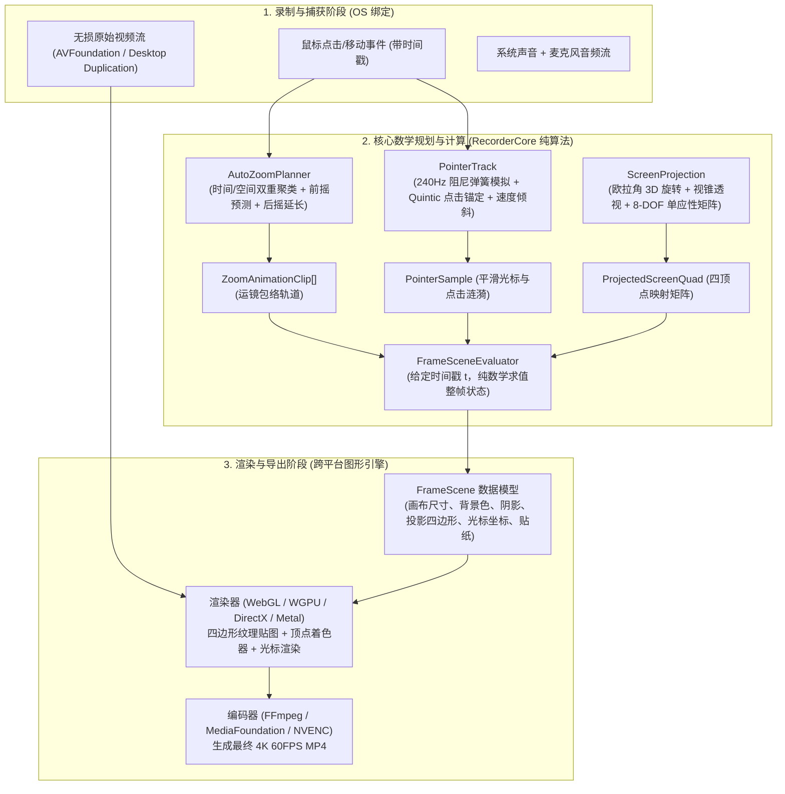
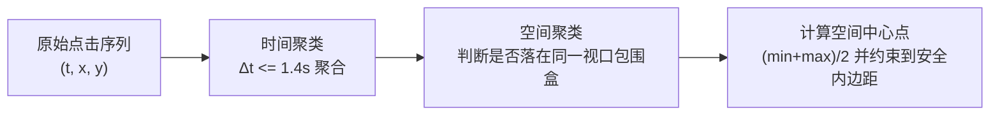
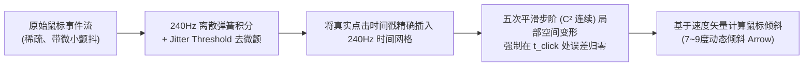

# DogSC `RecorderCore` 核心算法与数学架构深度解析

> **项目属性**：macOS 原生录屏剪辑工具 [DogSC (laogou717/dogsc)](https://github.com/laogou717/dogsc)  
> **本地源码路径**：`F:\dogsc`  
> **核心算法模块**：`F:\dogsc\Sources\RecorderCore`（约 2.2 万行纯 Swift/Foundation 代码，**零 macOS 平台依赖**）  
> **解析目标**：为后续使用跨平台技术栈（Rust / C# / TypeScript / WebGL / C++）重构 Windows 平台的平滑运镜录屏工具提供算法白皮书与技术规范。

---

## 目录
1. [系统总体解耦架构与数据流管道](#1-系统总体解耦架构与数据流管道)
2. [核心算法一：自动运镜规划器 (AutoZoomPlanner)](#2-核心算法一自动运镜规划器-autozoomplanner)
3. [核心算法二：弹簧动力学与贝塞尔运动插值 (ZoomAnimation)](#3-核心算法二弹簧动力学与贝塞尔运动插值-zoomanimation)
4. [核心算法三：3D 屏幕倾斜与单应性透视投影 (ScreenProjection)](#4-核心算法三3d-屏幕倾斜与单应性透视投影-screenprojection)
5. [核心算法四：240Hz 光标物理滤波与点击五次锚定 (PointerTrack)](#5-核心算法四240hz-光标物理滤波与点击五次锚定-pointertrack)
6. [帧场景求值器与渲染契约 (FrameSceneEvaluator)](#6-帧场景求值器与渲染契约-framesceneevaluator)
7. [下阶段技术重构路线与交付下游 AI 规格说明](#7-下阶段技术重构路线与交付下游-ai-规格说明)

---

## 1. 系统总体解耦架构与数据流管道

DogSC 的架构采用了极佳的**核心算法与平台实现完全解耦**的设计模式：
- **`DogSCApp` (平台外壳，~8 万行)**：负责与 macOS 专有生态对接（`ScreenCaptureKit` 采集屏幕/音频、`Metal`/`CoreImage` 纹理贴图、`AVFoundation`/`VideoToolbox` 硬件编解码、`AppKit`/`SwiftUI` 窗口交互）。
- **`RecorderCore` (纯数学计算核，~2.2 万行)**：**仅引入 `Foundation`**，不含任何图形库、系统窗体或特定硬件依赖。其职责是纯函数式的**“事件驱动规划 $\to$ 时间线求值 $\to$ 帧场景描述”**。



---

## 2. 核心算法一：自动运镜规划器 (`AutoZoomPlanner`)

源码位置：[`AutoZoomPlanner.swift`](file:///F:/dogsc/Sources/RecorderCore/AutoZoomPlanner.swift)

### 2.1 工业级运镜的三大核心痛点与解决思路
1. **防止频繁镜头抽动（Camera Jitter）**：用户如果在同一个表单、菜单或工具栏中连续点击几个按钮，如果每个点击都把镜头拉过去，观众会产生强烈的眩晕感。
   - **解法**：采用**时空双重聚类（Temporal-Spatial Dual Clustering）**。
2. **拒绝机械突兀感（Lack of Anticipation）**：如果用户点下去那一刻镜头才开始慢吞吞推进，会显得极其迟钝。
   - **解法**：**前摇预测（Anticipation Pre-roll）**，提前 18% 启动推镜。
3. **点完即退导致视野丢失（Premature Exit）**：点完按钮后，用户往往在等待加载或阅读下拉菜单，如果立即退镜，会错过核心信息。
   - **解法**：**鼠标活动延长机制（Activity Hold Extension）**，持续监听后续光标移动，直至光标静止后给予缓冲退镜。

### 2.2 算法实现详解

#### (1) 时间与空间双重聚类


- **第一级：时间窗口聚类（Temporal Grouping）**
  - 判定阈值：`clickGroupGap = 1.4s`。
  - 若 $t_i - t_{i-1} \le 1.4\text{s}$，归入同一个时间交互组。
- **第二级：动态视野空间聚类（Spatial Focus Grouping）**
  - 当前放大倍率为 $s$（如默认 1.6 倍），则可见视野跨度为 $\text{visibleExtent} = \frac{1}{\max(s, 1)}$。
  - 允许的最大水平跨度：$\text{maximumSpanX} = \text{visibleExtent} \times 0.50$
  - 允许的最大垂直跨度：$\text{maximumSpanY} = \text{visibleExtent} \times 0.70$
  - 只要组内所有点击的包围盒满足 $\max(X) - \min(X) \le \text{span}_X$ 且 $\max(Y) - \min(Y) \le \text{span}_Y$，**不产生新的镜头跳跃**，而是将所有焦点的中心作为稳定视口：
    $$\text{focus} = \left(\frac{\min(X) + \max(X)}{2}, \frac{\min(Y) + \max(Y)}{2}\right)$$

#### (2) 前摇与后摇控制
- **前摇（Enter Timing）**：
  $$t_{\text{start}} = \max(t_{\text{click1}} - t_{\text{enterDuration}} \times 0.18, t_{\text{earliestNextStart}}, 0)$$
  提前 $18\%$ 的进场时间启动平滑推镜，当点击发生的瞬间，镜头刚好以优美的姿态抵达放大位置。
- **后摇动态保持（Activity Hold Extension）**：
  - 在最后一个点击后，扫描所有鼠标移动事件：
  - 只要光标持续运动且相邻事件间隔 $\le 1.4\text{s}$，镜头就一直锁定保持！
  - 当光标彻底停止活跃后，额外保留 $\text{settleHold} = 0.55\text{s}$ 的停留观察期，最后再触发优雅的退镜（`exitDuration`）。

#### (3) 相邻包络融合（Merging Connected Envelopes）
- 如果相邻的两个自动运镜 clip 满足时间连续且缩放比一致，自动合并为一个长镜头，**彻底杜绝重置弹簧初始速度带来的二次急停顿挫**。

---

## 3. 核心算法二：弹簧动力学与贝塞尔运动插值 (`ZoomAnimation`)

源码位置：[`ZoomAnimation.swift`](file:///F:/dogsc/Sources/RecorderCore/ZoomAnimation.swift)

### 3.1 归一化欠阻尼简谐振动（Under-Damped Spring Dynamics）
为了达到 Apple 风格的高级质感，DogSC 没有使用粗糙的 CSS 贝塞尔缓动，而是基于经典物理二阶微分方程：
$$m \ddot{x} + c \dot{x} + k x = 0$$

- **物理参数定义**：
  - 质量 $m$（默认 $\approx 1.0$，安全下限 $0.01$）
  - 刚度 $k$（Stiffness，默认 $\approx 180.0$）
  - 阻尼系数 $c$（Damping，默认 $\approx 22.0$）
- **无阻尼固有角频率**：
  $$\omega_0 = \sqrt{\frac{k}{m}}$$
- **阻尼比（Damping Ratio）**：
  $$\zeta = \min\left(\frac{c}{2\sqrt{km}}, 0.9999\right) \quad (\zeta < 1 \text{ 保证处于欠阻尼振荡区间})$$
- **有阻尼振荡固有角频率**：
  $$\omega_d = \omega_0 \sqrt{1 - \zeta^2}$$
- **经典位移响应方程**：
  $$R(t) = 1 - e^{-\zeta \omega_0 t} \left[\cos(\omega_d t) + \frac{\zeta \omega_0}{\omega_d}\sin(\omega_d t)\right]$$
- **时间截断归一化（Boundary Normalization）**：
  物理弹簧理论上需要无限时间完全静止。DogSC 巧妙设置了基准参考时间 $T_{\text{ref}} = 0.72\text{s}$，并将响应函数归一化：
  $$\text{Progress}(t) = \text{clamp}\left(\frac{R(t \cdot T_{\text{ref}})}{R(T_{\text{ref}})}, 0, 1\right)$$
  > [!TIP]
  > **工程价值**：通过除以 $R(T_{\text{ref}})$，严格保证在 $t=1$ 时进度精确为 $1.000000$，彻底消除了动画末端的微小跳帧或坐标漂移！

### 3.2 高精度三次贝塞尔曲线求根（Newton-Raphson + Bisection）
当用户选用自定义贝塞尔曲线（如 $(x_1, y_1), (x_2, y_2)$）时，给定归一化时间 $X_{\text{target}}$，必须求解参数 $t \in [0, 1]$ 使得 $x(t) = X_{\text{target}}$，进而计算 $y(t)$。

DogSC 采用了**工业级两级求根策略**：
1. **第一级：牛顿-拉夫逊迭代（Newton-Raphson）**
   - 迭代公式：$t_{n+1} = t_n - \frac{x(t_n) - X_{\text{target}}}{x'(t_n)}$
   - 最多迭代 7 次，误差门限 $\epsilon = 10^{-5}$。
2. **第二级：二分法兜底（Bisection Fallback）**
   - 若一阶导数 $x'(t) \approx 0$（曲线极平坦产生奇点）或迭代越界，立即无缝降级为最多 18 次二分查找，保证 100% 稳定收敛，绝对不会产生 NaN 或无限循环！

---

## 4. 核心算法三：3D 屏幕倾斜与单应性透视投影 (`ScreenProjection`)

源码位置：[`ScreenProjection.swift`](file:///F:/dogsc/Sources/RecorderCore/ScreenProjection.swift)

DogSC 的高级功能之一是支持屏幕以 3D 角度倾斜（类似桌面展示、透视演示），同时保证**光标、贴纸、焦点框、拖拽控制手柄能精确贴合在倾斜后的 3D 屏幕表面**。

### 4.1 3D 欧拉角变换与相机模型
给定 2D 矩形 $R = [x, y, w, h]$，以锚点 $(x_{\text{pivot}}, y_{\text{pivot}})$ 为轴心进行旋转：
1. **依次绕 X 轴、Y 轴、Z 轴旋转**（旋转角分别为 $R_x, R_y, R_z$）：
   $$\begin{aligned}
   y_1 &= y \cos R_x, & z_1 &= y \sin R_x \\
   x_2 &= x \cos R_y + z_1 \sin R_y, & z_2 &= -x \sin R_y + z_1 \cos R_y \\
   x_3 &= x_2 \cos R_z - y_1 \sin R_z, & y_3 &= x_2 \sin R_z + y_1 \cos R_z
   \end{aligned}$$
2. **相机视锥投影（Perspective Camera Projection）**：
   - 设最大尺寸 $M = \max(w, h, 1)$，透视强度 $d \in [0, 2]$：
     $$\text{cameraDistance} = \frac{2M}{\max(d, 0.0001)}$$
   - 投影缩放因子：
     $$\text{scale}_{\text{proj}} = \frac{\text{cameraDistance}}{\max(\text{cameraDistance} - z_2, 0.12 \times \text{cameraDistance})}$$
   - 变换后坐标：
     $$(x', y') = (x_{\text{pivot}} + x_3 \cdot \text{scale}_{\text{proj}}, \; y_{\text{pivot}} + y_3 \cdot \text{scale}_{\text{proj}})$$
3. 得到投影后的四个角点：`topLeft`, `topRight`, `bottomRight`, `bottomLeft`（构成非轴对称凸四边形 `ProjectedScreenQuad`）。

### 4.2 8-DOF 单应性正投影与解析逆投影（Homography & Inverse Mapping）
将任意属于原始屏幕坐标系的点 $(u, v)$ 投影到 3D 倾斜四边形平面上，采用严格的射影几何公式：
$$\begin{bmatrix} x' \\ y' \\ 1 \end{bmatrix} \sim H \begin{bmatrix} u \\ v \\ 1 \end{bmatrix}$$

在 `ProjectedScreenPointMapper` 中展开为双线性分式变换：
$$X_{\text{proj}} = \frac{a \cdot u + b \cdot v + X_{\text{topLeft}}}{C_x \cdot u + C_y \cdot v + 1}, \quad Y_{\text{proj}} = \frac{d \cdot u + e \cdot v + Y_{\text{topLeft}}}{C_x \cdot u + C_y \cdot v + 1}$$

其中系数由四顶点联立方程直接求解：
- $\Delta x_1 = X_{\text{TR}} - X_{\text{BR}}, \quad \Delta x_2 = X_{\text{BL}} - X_{\text{BR}}, \quad \Delta x_3 = X_{\text{TL}} - X_{\text{TR}} + X_{\text{BR}} - X_{\text{BL}}$
- 分母分式行列式：$D = \Delta x_1 \Delta y_2 - \Delta x_2 \Delta y_1$
- 透视项：
  $$C_x = \frac{\Delta x_3 \Delta y_2 - \Delta x_2 \Delta y_3}{D}, \quad C_y = \frac{\Delta x_1 \Delta y_3 - \Delta x_3 \Delta y_1}{D}$$
- 映射系数：
  $$\begin{aligned}
  a &= X_{\text{TR}} - X_{\text{TL}} + C_x X_{\text{TR}}, & b &= X_{\text{BL}} - X_{\text{TL}} + C_y X_{\text{BL}} \\
  d &= Y_{\text{TR}} - Y_{\text{TL}} + C_x Y_{\text{TR}}, & e &= Y_{\text{BL}} - Y_{\text{TL}} + C_y Y_{\text{BL}}
  \end{aligned}$$

同时，模块给出了**确定性的解析求逆算法（Exact Unproject）**，使得鼠标在播放器视口中的任意点击交互，都能瞬时、无近似误差地反算回屏幕内部原始坐标！

---

## 5. 核心算法四：240Hz 光标物理滤波与点击五次锚定 (`PointerTrack`)

源码位置：[`PointerTrack.swift`](file:///F:/dogsc/Sources/RecorderCore/PointerTrack.swift)

这是 DogSC 最惊艳也是所有录屏工具的核心秘密所在。

### 5.1 传统鼠标平滑算法的致命缺陷
如果直接用弹簧或低通滤波平滑鼠标轨迹：
- **延迟滞后**：平滑后的鼠标在点击发生时刻往往落后实际位置几个到几十个像素；
- **误击假象**：画面上点击水波纹播放了，但鼠标指针还在按钮外面 10 像素处！
- **硬校正卡顿**：如果在点击帧强行把坐标 snap 到真实点击点，会导致鼠标瞬间瞬移或发生速度不连续（一阶导数跳变），肉眼可见抽搐。

### 5.2 DogSC 的双阶段后处理解法



#### (1) 240Hz 高频弹簧离散积分
- 仿真步长 $\Delta t = \frac{1}{240}\text{s}$。
- **微颤抑制门限（Jitter Threshold）**：
  $$\Delta x^2 + \Delta y^2 \ge (0.00035)^2$$
  光标微小的手部生理性震颤会被自动过滤，避免弹簧持续在微小幅度产生高频嗡鸣。
- 采用半隐式欧拉法迭代更新速度与位置：
  $$\vec{a}_{t} = \frac{k(\vec{X}_{\text{target}} - \vec{X}_{t}) - c \vec{v}_{t}}{m}, \quad \vec{v}_{t+\Delta t} = \vec{v}_t + \vec{a}_t \Delta t, \quad \vec{X}_{t+\Delta t} = \vec{X}_t + \vec{v}_{t+\Delta t} \Delta t$$

#### (2) 五次平滑步阶（Quintic Smoother-Step）点击锚定算法
在点击时间点 $t_{\text{click}}$ 附近构建局部变形窗口：$[t_{\text{click}} - 0.18\text{s}, t_{\text{click}} + 0.18\text{s}]$。
- 引入五次多项式核函数：
  $$S(u) = 6u^5 - 15u^4 + 10u^3 \quad (u \in [0, 1])$$
- **数学特性**：
  - $S(0) = 0, \quad S(1) = 1$
  - 一阶导数：$S'(0) = 0, \quad S'(1) = 0$（速度无缝衔接）
  - 二阶导数：$S''(0) = 0, \quad S''(1) = 0$（加速度无缝衔接，具备严格的 $C^2$ 连续性）
- **位移修正（Offset Blending）**：
  计算弹簧轨迹在点击时刻与真实点击点的物理偏差 $\vec{E} = \vec{X}_{\text{real\_click}} - \vec{X}_{\text{spring}}(t_{\text{click}})$。
  在变形窗口内，将 $\vec{E}$ 乘以根据 $S(u)$ 构造的双向平滑权重，无损叠加入平滑轨迹中！
  > [!IMPORTANT]
  > **效果**：光标在远离点击时是完美的物理弹簧运动；在接近点击时被完全不可察觉地平滑“吸引”到按钮中心；点击发生的瞬间，指针尖端（Hotspot）与真实按钮像素**100% 绝对重合**；点击之后又自然滑出！

#### (3) 物理动态倾角（Rotational Motion Tilt）
真实世界中拖动重物时会产生微小的拖拽倾角。DogSC 在采样光标时：
- 提取过去 $50 \sim 80\text{ms}$ 的速度矢量 $\vec{v}$。
- 赋予光标最大 $7^\circ \sim 9^\circ$ 的动态自适应旋转角：
  $$\theta = \text{atan2}(v_y, v_x) \times \text{strength}$$
- 旋转中心严格绑定在光标的热点（Hotspot）上，使得倾斜时指针尖端永远稳如磐石！

---

## 6. 帧场景求值器与渲染契约 (`FrameSceneEvaluator`)

源码位置：[`FrameScene.swift`](file:///F:/dogsc/Sources/RecorderCore/FrameScene.swift)

`FrameSceneEvaluator` 是连接核心数学逻辑与图形渲染引擎的纯数据接口。它接受一个时间戳 `time: Double`，返回一个不可变的纯数据结构 `FrameScene`：

```swift
public struct FrameScene: Equatable, Sendable {
    public var size: CompositionSize               // 最终画布输出分辨率 (如 3840x2160)
    public var background: FrameBackgroundScene     // 背景层 (纯色 / 渐变 / 壁纸纹理)
    public var shadow: FrameShadow                 // 窗口后投影 (模糊半径、扩散、偏移、透明度)
    public var screenChrome: FrameScreenChromeScene// 窗口饰件 (macOS 红黄绿胶囊按钮、圆角、高光边框)
    public var screen: FrameScreenScene            // 屏幕主体层 (包含 3D 投影后的 4 个坐标顶点)
    public var camera: FrameCameraScene?           // 摄像头人像画中画 (圆形/圆角/矩形、坐标、边框)
    public var cursor: FrameCursorScene?           // 光标层 (投影后位置、图标资源ID、缩放、点击扩散涟漪)
    public var stickers: [FrameStickerScene]       // 贴纸与标注层 (入场/退场贝塞尔动画状态)
}
```

任何现代图形渲染后端（WebGL/Canvas2D、DirectX、Vulkan、WGPU/Metal）只需要做一件事：**根据每帧传入的 `FrameScene` 结构体进行绘制，完全无需理会任何交互与时间线状态机！**

---

## 7. 下阶段技术重构路线与交付下游 AI 规格说明

基于上述对 `RecorderCore` 的彻底解构，如果你后续让更高阶的推理模型接手搭建跨平台/Windows 技术重构方案，可直接将本章节作为 **Prompt / PRD 基础规范** 交付给下游 AI。

### 7.1 跨平台重构推荐技术栈对比

| 技术方案 | 图形渲染与捕获能力 | 开发与移植成本 | 性能与包体积 | 适用定位 |
| :--- | :--- | :--- | :--- | :--- |
| **Rust + Tauri + WGPU** *(强烈推荐)* | 极高 (直接调用 Windows Desktop Duplication API + DirectX/Vulkan) | 中等 (Rust 的数学与内存模型极适合 1:1 转译 `RecorderCore`) | 极高性能 (原生编译，体积 < 30MB) | 商业级轻量高颜值桌面产品 |
| **C# .NET 9 + WPF/WinUI 3 + SharpDX** | 极高 (原生对接 Windows MediaCapture / DXGI Desktop Duplication) | 低 (C# 语法与 Swift 高度接近，转译极其顺畅) | 优秀 (Windows 专属，内存略大) | Windows 生态深度集成方案 |
| **Electron + WebGL/Canvas + Node Addon** | 中高 (捕获需借助 C++ Addon，渲染用 Pixi.js / Three.js) | 最低 (UI 界面与时间线直接用 React/Vue) | 资源占用较高 (包体积 150MB+) | 快速验证 MVP 原型 |

### 7.2 下游 AI 接手提示词模版 (Prompt for Senior Architecture AI)

````markdown
你现在是顶级多媒体架构师。我们正在重构一款类似于 macOS DogSC / Screen Studio 的高颜值平滑运镜录屏工具（运行在 Windows 平台）。
我们已经对原始项目 `dogsc/Sources/RecorderCore` 完成了完整的逆向数学建模与算法解构（详见文档 `dogsc_core_algorithm_deep_dive.md`）。

请基于该算法规范，分步输出技术架构设计文档 (PRD & Tech Spec)：
1. 模块边界设计：
   - `core-math`：实现 NormalizedUnderdampedSpring、BezierNewtonSolver、HomographyMapper (8-DOF)、PointInPolygon。
   - `planner`：实现 TemporalSpatialCluster、PreRollAnticipation、ActivityHoldExtension、EnvelopeMerger。
   - `pointer`：实现 240HzSpringSimulator、QuinticSmootherStepAnchor、RotationalTilt。
   - `scene`：定义纯数据 FrameScene 模型。
2. Windows 平台特有层设计：
   - 屏幕画面与音频捕获：使用 Windows Graphics Capture API (DirectX 11/12 Texture Sharing)。
   - 鼠标输入捕获：使用 Raw Input API 采集高精度、无加速度修改的绝对光标坐标。
3. 给出各核心算法模块的严谨接口签名与单元测试验证集（含极限测试用例：如 0 间隔连击、跨越屏幕极限旋转等）。
````
